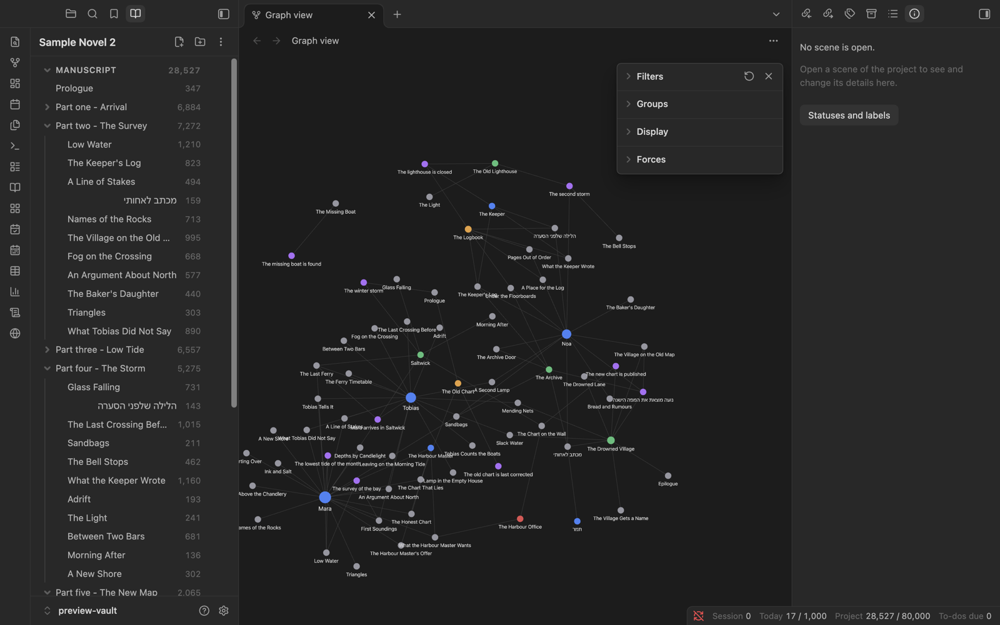

# Spellbook

Spellbook is a plugin for [Obsidian](https://obsidian.md) for planning and writing novels. It gives a vault the tools of a dedicated novel-writing app: a binder of scenes, a corkboard, word targets, a story timeline, notes on characters and places, saved versions of a scene and a manuscript export. It is for writers who want those tools and still want their book to stay a folder of plain notes that they own. It was built for writing in Hebrew and English, on a computer, a tablet and a phone.

Made by Daniel at DandiMage.

**Status:** version 0.10.0, pre-release. Every screen has been looked at on a Mac in a test copy of Obsidian, and most of them in Obsidian's phone layout at phone size. Nothing has been tried on a real iPhone or iPad yet. Spellbook is not in Obsidian's community plugin list. See [Known limits](docs/guide.md#known-limits).

## Learn

- [Installing Spellbook](docs/installing.md). For testers: with BRAT, which updates by itself, or by copying three files; on a computer, an iPhone or an iPad.
- [Tutorial: your first novel in Spellbook](docs/tutorial.md). A walk-through from an empty vault to a Word file for a reader, in numbered steps.
- [User guide](docs/guide.md). The reference: every screen, every command, how your writing is stored, and the known limits.
- [Customising: making Spellbook your own](docs/customising.md). Colour schemes, keyboard shortcuts, the bottom bar, statuses and labels, and where each setting lives.
- [AI helper](AI%20helper/README.md). A reference to hand to an AI assistant, so that it can help with a project without breaking it.

## Screens

### Binder, scene and inspector


*The book as a tree in the left sidebar, a scene open in the editor, and the scene's synopsis, status, label and target in the right sidebar.*

### Corkboard


*One index card per scene, with its title, synopsis, status, coloured label and word count.*

### Timeline


*Story events as cards in named, coloured lanes on one time axis.*

### Novel view


*The manuscript as one continuous page to read through.*

### World


*A card for each character, place, faction, item, piece of lore, creature and culture of the story.*


*The same world as a list that sorts by name, type, kind or number of scenes.*

### Character and lore sheets


*A character's sheet beside the World cards: role, occupation, personality, voice and arc, the people and places related to her, and the scenes she is in.*


*Lore has its own type: legends, tales, history and customs, linked to the scenes and events where they matter.*

### World history


*Characters, places and legends can carry dates and moments. The timeline shows them as lanes beside the story's events, and each sheet lists its own history.*

### Plot grid


*The plot grid with characters as columns. The bar under each name shows where in the book they appear; grey marks a long stretch without them.*

### Idea boards


*A relationship map that Spellbook drew from the relations in World, on Obsidian's own Canvas.*

### Story graph



*Obsidian's graph view of the sample novel: scenes in grey, characters in blue, places in green, factions in red, items in orange, lore in yellow, creatures in cyan, cultures in pink, timeline events in purple. The links come from the entities listed on each scene and event.*

### On a phone


*The World screen in Obsidian's phone layout: the same cards in one column.*


*A character's sheet in phone layout: it takes the place of the list, with a button that leads back.*

### Welcome


*The first time Spellbook runs it offers the sample novel, a new project or the tutorial, and a short tour.*

## Features

### Get started

- **Welcome page.** The first time Spellbook runs in a vault with no project, a page offers the sample novel, a new project or the tutorial, with a short tour of the screen and a list of where things are. A **Help** pane lists every command, and a short note shows what is new after each update.
- **Templates.** Start a project from a story structure (three acts, a fifteen-beat outline, the hero's journey, chapter by chapter), with placeholder scenes that say what belongs where. Save your own scenes, World entries and whole projects as templates.

### Organise

- **Binder.** The project as a tree in the sidebar: scenes and folders, each with its word count. Add, rename, nest, reorder by dragging or with "Move up" and "Move down", and delete to the trash.
- **Corkboard.** The scenes as index cards with title, synopsis, status, coloured label and word count. Drag to reorder; open a folder card to see what is inside it.
- **Outliner.** The manuscript as a table: status, label, target, words, synopsis, tags, tasks, read time and dates, with a row of totals, sorting, filtering and columns of your own.
- **Inspector.** A side panel for the open scene: synopsis, status, label, word target, whether it is included in the export, and who and what is in the scene.
- **Plot grid.** Scenes down the side and plotlines across the top: timeline lanes, labels, characters, places or entities you choose. A tick where a scene belongs to one, a tap to change it, and grey stretches where a character or a plotline goes missing.

### Write

- **Writing modes.** Zen (hides the interface), letter box (lights a band of lines), typewriter (keeps the line you are writing at one height) and Hemingway (nothing can be deleted). They work in any note.
- **Novel view.** The whole manuscript, or one folder, as one continuous page to read through. Tap a paragraph to open its scene at that place.
- **Prose checks.** Marks in the editor for filler words, the passive voice, repeated words, crowded adverbs and sentence rhythm, and colours for nouns, verbs, adjectives and adverbs. Some checks are English only; repeated words, filler words and rhythm also work in Hebrew. The text itself is never changed.
- **Colour schemes.** Six palettes to write in (Paper, Sepia, Mist, Dusk, Ink, Ember) on top of whatever Obsidian theme you use.

### Track

- **Word counts and bottom bar.** A bar at the bottom of the window with the figures you choose: scene words, session words, words today, project words, dates, status and more. On a phone the same figures stand at the top of the inspector.
- **Targets.** A target for the project, for a day and for each scene, and a deadline.
- **Calendar and to-dos.** A month view of the words written each day, to-dos that are due, and days you mark with a colour and a short label. To-dos are plain checkbox lines in one note.
- **Writing report.** Words, characters, sentences, paragraphs, pages, reading time, a reading grade and the most used words, for a scene, a folder or the whole manuscript.

### Plan the story

- **Timelines.** Named, coloured lanes on one time axis. Events are notes; scenes that have a date appear too. Zoom, drag an event to change its date, and switch between date order and story order.
- **World history.** Give characters, places and other entities dates and moments, and see them on the timeline: a lane for each type, spans from birth to death or founding to fall, with the world's history one command away.
- **Invented calendars.** Give a story its own months, week, eras and leap years, and the timeline counts in it.
- **World.** Characters, places, factions, items, lore (legends, tales, history), creatures and cultures, plus types of your own. Each is a plain note with a sheet: a picture, fields you fill in place, when it begins and ends and the moments of its life, relations to other entities, the scenes and events it appears in, and its whole history in order of time. Browse them as cards or as a sortable list, link them to scenes and timeline events, and find scenes that mention one without listing it.
- **Story graph.** Scenes and timeline events link to the characters, places, lore and other entities listed on them with ordinary Obsidian links, so Obsidian's own graph view and backlinks show who appears where, with no setup. Give each kind of note its own colour with the graph's Groups setting.
- **Idea boards.** Free boards for loose ideas, on Obsidian's own Canvas. Turn a card into a scene or a World entry; have Spellbook draw a relationship map of your characters, a chapter as cards, or the web around one entity.

### Keep and share

- **Snapshots.** Save a scene as it is now, list its earlier versions, compare two and restore one. The text from before a restore is always saved first.
- **Export.** The manuscript as a Word document, an e-book (EPUB), a web page, one Markdown note, or a page laid out for printing and saving as a PDF. Presets for an agent, a reading copy and a proof; dedication, epigraph, acknowledgements and about the author; a new page or a title for any scene.

## How a project is stored

A project is an ordinary folder of Markdown notes in your vault. You can read, edit, move and back up every part of it without the plugin. Spellbook keeps what it needs in note properties and in one index note; it has no database.

```
<Project>/
  <Project>.md   the project index: binder order, statuses and labels, targets, timeline lanes, day marks
  To-do.md       to-dos as plain checkbox lines
  Manuscript/    one note per scene
  Timeline/      one note per timeline event
  Research/      your research notes
  Stats/         daily word logs, one file per device per month
  World/         one note per character, place, faction, item, piece of lore, creature or culture (made when you add the first)
  Snapshots/     saved versions of scenes (made when you take the first)
  Exports/       exported manuscripts (made when you first export)
  AI helper/     a reference for AI assistants (made when you ask for it)
```

Spellbook only works inside project folders. It does not change notes elsewhere in the vault.

## For AI assistants

Because a project is plain notes, an AI assistant can read it and help: summarise a chapter, list the scenes a character is in, draft a synopsis, add a to-do or a character note. To do that without breaking anything, the assistant has to know what the files mean and what it must leave alone. The folder [AI helper](AI%20helper/README.md) holds a reference written for that reader: [Spellbook for AI assistants](AI%20helper/Spellbook%20for%20AI%20assistants.md).

- Paste the file into a chat with your assistant, or
- point an assistant that works with files at your vault and tell it to read the file first, or
- run the command **Create AI helper note**, which puts a copy inside the open project, at `AI helper/Spellbook for AI assistants.md`.

Spellbook itself contains no AI and sends nothing anywhere. The file is only text for an assistant of your choosing to read.

## Speed

Spellbook is tested on a full-length novel: about 80,000 words in 290 scenes, with 200 World entries and 300 timeline events. On such a book Obsidian starts in under a second with Spellbook on, every screen opens in about half a second or less, and typing stays smooth with prose checks, typewriter scrolling and the bottom bar all on.

## Hebrew and English

Spellbook supports Hebrew and English, including right-to-left text. Menus and buttons are in English. Your own text (titles, synopses, names, labels) can be in Hebrew, English or both: each piece of text takes the direction of its own language, so Hebrew reads right to left next to English that reads left to right. Word counts handle both languages. The Word and web-page exports mark Hebrew text as right to left.

## Desktop, iPad and iPhone

Spellbook is written to work on all three. It uses no desktop-only features of Obsidian, every action has a button or a menu entry as well as a drag, and layouts follow the width of the pane and not the kind of device. This is by design and has been checked in Obsidian's phone layout on a Mac; it has not yet been tried on a real iPhone or iPad.

## Installing by hand

Spellbook is not in the community plugin list, so for now it is installed by copying three files. The full steps, including the BRAT way that updates by itself and how to install on an iPhone or iPad, are in [Installing Spellbook](docs/installing.md).

1. Get `main.js`, `manifest.json` and `styles.css` (build them from source as described below).
2. In your vault, make the folder `<vault>/.obsidian/plugins/spellbook-novel-writer/`.
3. Copy the three files into it.
4. In Obsidian, open Settings, then Community plugins, and switch on **Spellbook**. If it is not listed, restart Obsidian.

Spellbook needs Obsidian 1.8.7 or later. To try it without touching your own writing, run the command "Spellbook: Create sample project" in a spare vault.

## Building from source

You need [Node.js](https://nodejs.org) and npm.

```
npm install
npm run build
npm test
```

`npm run build` checks the TypeScript and writes `main.js` and `styles.css` at the top of the repository; `manifest.json` is already there. `npm run dev` rebuilds on every change. `npm test` runs the unit tests.

## Privacy

Spellbook makes no network requests and collects nothing: no telemetry, no analytics, no accounts. Everything is worked out on your device, and everything it saves goes into your vault or into Obsidian's own storage on the device.

What was checked to say this: the whole of `src/` was searched for `fetch`, `XMLHttpRequest`, Obsidian's `requestUrl`, `WebSocket`, `sendBeacon`, `eval`, `new Function`, dynamic `import()`, `require()`, web addresses, and imports of Node.js or Electron modules. The only matches are the fixed format names that a Word file must carry inside it (they look like web addresses but are never contacted), and the addresses of the guide and the tutorial, which the Help pane shows as text to copy and never opens. The "What is new" note after an update is bundled in the plugin; nothing is fetched. The stylesheets load no remote fonts or images, and the plugin has no runtime dependencies beyond Obsidian itself.

## Licence

MIT. Copyright © 2026 DandiMage. See [LICENSE](LICENSE).
