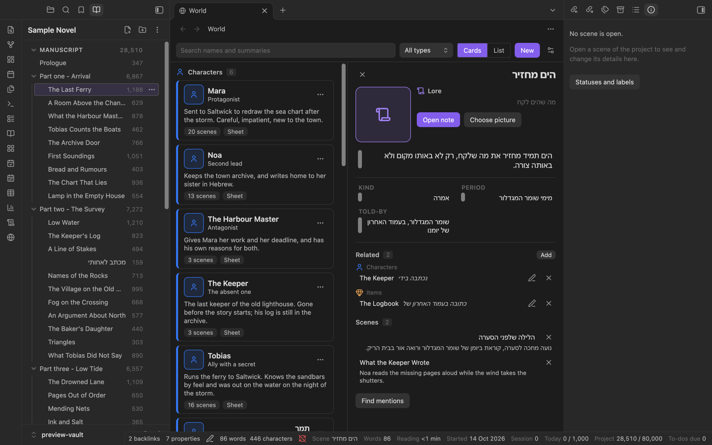

# Spellbook user guide

This guide explains every screen and tool of Spellbook, a plugin for Obsidian for planning and writing novels. It describes version 0.9.0.

This is the reference: one section per screen. If you are new to Spellbook, start with the [tutorial](tutorial.md), which walks through a first novel step by step. To change colours, keys, bars and lists, see [Making Spellbook your own](customising.md).

Two things to know before you start:

- **Commands.** Most things are opened with a command. Open Obsidian's command palette (swipe down on a phone, or press Ctrl+P or Cmd+P on a computer) and type the name. Obsidian shows every Spellbook command with "Spellbook:" in front, for example "Spellbook: Open binder". This guide gives the names without that prefix. Spellbook sets no keyboard shortcuts of its own; you can give any command a shortcut in Obsidian's Hotkeys settings.
- **Ribbon buttons.** Some screens also have a button in Obsidian's ribbon (the strip of icons at the side of the window, or in the menu on a phone). Their names are given below as they appear when you point at them.

Nothing here has been tried on a real iPhone or iPad yet. Where this guide says how something behaves on a phone, that is how it was built, and how it looked in Obsidian's phone layout on a Mac. See [Known limits](#known-limits).

## Contents

Other pages:

- [Tutorial: your first novel in Spellbook](tutorial.md)
- [Customising: making Spellbook your own](customising.md)

In this guide:

- [Getting started](#getting-started)
- [Binder](#binder)
- [Corkboard](#corkboard)
- [Inspector](#inspector)
- [Statuses and labels](#statuses-and-labels)
- [Outliner](#outliner)
- [Novel view](#novel-view)
- [Writing modes](#writing-modes)
- [Prose checks](#prose-checks)
- [Colour schemes](#colour-schemes)
- [Word counts and the bottom bar](#word-counts-and-the-bottom-bar)
- [Writing targets](#writing-targets)
- [Planner: calendar and to-dos](#planner-calendar-and-to-dos)
- [Writing report](#writing-report)
- [Timeline](#timeline)
- [Story calendar](#story-calendar)
- [World](#world)
- [Snapshots](#snapshots)
- [Export](#export)
- [For AI assistants](#for-ai-assistants)
- [Settings](#settings)
- [All commands](#all-commands)
- [How your writing is stored](#how-your-writing-is-stored)
- [Sync and several devices](#sync-and-several-devices)
- [Known limits](#known-limits)

## Getting started

### Try the sample project

Run the command **Create sample project**. Spellbook makes a folder called "Sample Novel" (or "Sample Novel 2", and so on, if there is one already) with a made-up novel of about fifty scenes in English and Hebrew, with characters, places, timeline events and to-dos. It has no writing history, so the calendar's word counts start empty. It is there so that every screen has something to show. It is an ordinary folder; delete it when you are done.

### Create your own project

1. Run the command **Create project**.
2. In the window, type a **Name**. The project gets its own folder with this name.
3. Choose a **Location**: the folder to create the project in.
4. Press **Create**.

Spellbook makes the folder with a first scene in it, and opens that scene. To see the project as a tree, open the binder with the command **Open binder** or the ribbon button "Open Spellbook binder".

A vault can hold several projects. One of them is "the open project" on each device, and every screen shows that one. Switch between them from the project's name at the top of the binder.

Loading the plugin changes nothing in your vault. Notes are only made when you run a command.

## Binder


*The binder in the left sidebar, with a scene open in the editor and the inspector in the right sidebar.*

**What it is for.** The binder is the project as a tree: your scenes and folders in the order of the book.

**How to open it.** Command **Open binder**, or the ribbon button "Open Spellbook binder". It opens in the left sidebar. There is only ever one binder.

**What you see.**

- The project's name at the top. When the vault has more than one project, pressing it lets you choose another.
- A toolbar with **New scene**, **New folder** and a "More options" menu with **Collapse all**, **Expand all**, **Create project** and **Create sample project**.
- **Manuscript**: your scenes and folders. Each row shows its word count.
- **Unfiled**: notes that are in the Manuscript folder but not in the binder yet (for example, notes you made in Obsidian's own file list).
- **Research**: the notes in the Research folder.

**What you can do.**

- Tap a scene to open it.
- Every row has a "More options" button that opens its menu; a right-click opens the same menu.
  - A scene: **Rename**, **Move up**, **Move down**, **Move to folder**, **Open in new tab**, **New scene below**, **Take snapshot**, **Snapshots**, **Delete scene**.
  - A folder: **Show on corkboard**, **New scene inside**, **New folder inside**, **Rename**, **Move up**, **Move down**, **Move to folder**, **Remove folder (keeps scenes)**.
  - An unfiled note: **Add to manuscript**, **Open**, **Open in new tab**.
  - A scene whose note has gone missing: **Remove from binder**.
- Drag a scene or a folder to another place, or drag an unfiled note into the manuscript.
- With a keyboard: Up and Down go from row to row, Left and Right fold and unfold, Enter opens.

**Deleting.** "Delete scene" asks first, then takes the scene out of the binder and moves its note to the trash. Nothing is deleted outright.

**Commands that act on the binder.** **New scene**, **New folder**, **Move scene up**, **Move scene down** and **Reveal active scene in binder** (shows the binder with the row of the note you are working on selected). They are only offered while they can do something.

**On a phone.** Long-press a row to pick it up and drag it. Everything a drag does, the row's menu does too.

**Limits.** If the project's index note cannot be understood, the binder says "This project is read-only" and changes nothing until the note is put right. If two devices changed the binder before syncing, a notice appears with **Merge** and **Dismiss**; see [Sync and several devices](#sync-and-several-devices).

## Corkboard


*The corkboard: one index card per scene, with its title, synopsis, status, coloured label and word count.*

**What it is for.** Seeing the shape of the book: each scene is an index card with its title, the start of its synopsis, its status, its coloured label and its word count.

**How to open it.** Command **Open corkboard**, the ribbon button "Open Spellbook corkboard", or **Show on corkboard** in a folder's menu in the binder. It opens as a tab in the main area.

**What you can do.**

- The board shows the whole manuscript or one folder. A folder is one card that stands for everything inside it; tap it to go into that folder. The trail at the top shows where you are, and each step of it can be tapped to go back up.
- Tap a scene card to open the scene.
- Drag a card to reorder it, or drop it onto a folder card to put it inside.
- Choose the card size: **Small**, **Medium** or **Large**.
- Each card has a "More options" menu: **Open**, **Open in new tab**, **Move earlier**, **Move later**, **Set status**, **Set label**, **Edit synopsis**.
- The board's own "More options" menu opens **Statuses and labels**.
- With a keyboard: the arrow keys go from card to card, Enter opens.

**On a phone.** Long-press a card to pick it up. "Move earlier" and "Move later" do the same without dragging. The number of columns follows the width of the pane.

**Limits.** The card size is remembered on each device separately.

## Inspector

**What it is for.** Seeing and changing the details of the scene that is open.

**How to open it.** Command **Open inspector**. It opens in the right sidebar. It has no ribbon button.

**What you can change.**

- **Synopsis**: a short summary of the scene.
- **Status** and **Label**: chosen from the project's lists. The **Statuses and labels** button opens the window that edits those lists.
- **Target (words)**: how many words the scene should come to. Leave it empty for no target.
- **Include in compile**: when this is off, the scene is left out of an export.
- **Created** and **Edited**: the dates the scene was started and last changed. Spellbook keeps these for you.
- **In this scene**: the characters, places, factions and items the scene involves. Press **Add** to choose from the world or to type a new name. Each one shows as a chip that can be taken out again. See [World](#world).

**On a phone.** A phone has no bottom bar, so the line of word figures (see [Word counts and the bottom bar](#word-counts-and-the-bottom-bar)) stands at the top of the inspector. The shortcut buttons you added to the bar stand there too, on a phone and on a tablet.

**Limits.** The inspector shows scenes of the open project only. For any other note it says "No scene is open."

## Statuses and labels


*The "Statuses and labels" window: each status and label has a colour, arrows to move it and a menu.*

**What it is for.** A status says how far along a scene is. A label is a colour of your own choosing, for a point-of-view character, a plot line or anything else.

**How to open it.** Command **Manage statuses and labels** (offered while a project is open), the **Statuses and labels** button in the inspector, or the corkboard's menu.

**What you can do.** A new project starts with the statuses To do, First draft, Revised and Final. In the window you can **Add status** and **Add label**, give each a colour, move them up and down, and **Rename**, **Change colour** or **Remove** them from each one's menu. Renaming a status or label changes it in the scenes that use it. Names used by scenes but missing from the list are shown under "Used by scenes, but not in the list" with an **Add** button.

## Outliner


*The outliner: the manuscript as a table, with a row of totals for each folder and for the whole book.*

**What it is for.** The manuscript as a table, one row per scene under its folders, for checking and tidying many scenes at once.

**How to open it.** Command **Open outliner**, or the ribbon button "Open Spellbook outliner". It opens as a tab in the main area.

**The columns.** Name, Status, Label, Target, Words, Synopsis, Tags, Tasks, Read time, Compile, Created, Edited, and a row number. A first row sums up the whole manuscript, each folder sums up its scenes, and a **Total** row stands at the foot.

**What you can do.**

- Tap a Status or Label cell to change it, a Target or Synopsis cell to type in it, and the Compile box to switch a scene in or out of the export.
- Type in the box "Filter by title or synopsis", and use the **Status** and **Label** buttons to show only some scenes.
- Tap a column heading to sort by it; tap again to turn the sort round. A chip above the table says what the table is sorted by and clears it.
- The **Columns** button: show and hide columns, **Add property column** (a column for any property your scenes have), **Reorder columns**, **Reset columns**.
- A right-click on a column heading opens a menu for that one column: **Sort ascending**, **Sort descending**, **Clear sort**, **Hide column**, **Move earlier**, **Move later**.
- Each row has a "More options" menu: **Open**, **Open in new tab**, **Expand** or **Collapse** (folders), **Move up**, **Move down**.
- Drag a row to reorder it.

**On a phone.** A narrow pane shows a shorter list of columns. Long-press a row to pick it up; "Move up" and "Move down" do the same.

**Limits.** Tags come from a note's properties, not from #tags written in the text. Columns, sorting and filters are remembered on each device separately.

## Novel view


*The novel view: the scenes one after another as a single page, each under a small divider.*

**What it is for.** Reading the manuscript as one continuous page, scene after scene, each under a small divider with its title and word count.

**How to open it.** Command **Open novel view**, or the ribbon button "Open Spellbook novel view". It opens as a tab in the main area.

**What you can do.**

- Choose which scenes are shown: **Whole manuscript**, or one folder of the binder.
- Tap a paragraph, a scene's title or its **Edit** button. The scene's own note opens in Obsidian's editor at that paragraph. When you save, the novel view shows the change.
- The view remembers where you were reading.

**On a phone.** It works the same; the header is laid out for a narrow pane.

**Limits.** The novel view is for reading. You cannot type in it: Obsidian gives plugins no supported way to put a working editor for one note inside another screen. Tap to open the scene, and edit it there.

## Writing modes


*Letter box mode: a band of lines stays lit, and the text above and below it is covered.*


*Zen mode: the sidebars, the tabs and the bars are hidden, and only the text is left.*

**What they are for.** Four switches that change how the editor behaves while you write. They work in any note, not only in scenes, and can be on together.

**How to switch them.** Each has a command that turns it on and off:

| Mode | Command | What it does |
| --- | --- | --- |
| Zen | **Toggle Zen mode** | Hides the interface around the note. |
| Letter box | **Toggle letter box mode** | Covers the page except for a band of lines. |
| Typewriter | **Toggle typewriter mode** | Keeps the line you are writing at one height. |
| Hemingway | **Toggle Hemingway mode** | Refuses deleting, so that a draft only moves forward. |

**Leaving Zen.** Press Escape, or run the command again. While Hemingway mode is on, a lock is shown in the note's header (in the corner of the screen during Zen); press it to switch the mode off.

**Settings** (under "Writing modes"):

- **Letter box: height of the band** and **Letter box: text outside the band** (Hidden, Barely visible or Dimmed).
- **Typewriter: where the line rests**.
- **Zen: hide properties**, **Zen: hide the title** and **Zen: leave with Escape**.

**On a phone.** A phone or tablet has no Escape key, so Zen shows a small "Leave Zen mode" button in the corner of the screen.

**Limits.** Which modes are on, and their settings, are remembered on each device separately. Typewriter scrolling while typing has not been watched on screen yet.

## Prose checks


*Prose checks: marks in the editor on words and sentences worth a second look.*

**What they are for.** Marks in the editor that point at things worth a second look. They only change how the text looks, never the text itself. They show in the notes of Spellbook projects.

**How to switch them.** Everything is off until you switch it on. **Toggle prose checks** switches all of them on or off together; the first time, it turns on filler words, passive voice, repeated words, overused adverbs and sentence rhythm. Each check also has its own command:

| Check | Command | Languages |
| --- | --- | --- |
| Colour nouns | **Toggle prose check: colour nouns** | English |
| Colour verbs | **Toggle prose check: colour verbs** | English |
| Colour adjectives | **Toggle prose check: colour adjectives** | English |
| Colour adverbs | **Toggle prose check: colour adverbs** | English |
| Filler words | **Toggle prose check: filler words** | English and Hebrew |
| Passive voice | **Toggle prose check: passive voice** | English |
| Repeated words | **Toggle prose check: repeated words** | English and Hebrew |
| Overused adverbs | **Toggle prose check: overused adverbs** | English |
| Sentence rhythm | **Toggle prose check: sentence rhythm** | English and Hebrew |

**Settings** (under "Prose checks"): a switch for all the checks and one for each; **Repeated words: how close**; **Sentence rhythm: a long sentence**; **Your own filler words (English)** and **Your own filler words (Hebrew)**.

**On a phone.** The marks are worked out when typing pauses, so that the line being typed is not disturbed.

**Limits.** English word colouring is a best guess from word lists and endings: right about nine times in ten, worse in dialogue. In Hebrew, a repeated word counts as the same with or without the letters attached to its front, which gives an occasional false match. The small bubble that explains a mark has not been tried on screen. The choices are remembered on each device separately.

## Colour schemes


*The Sepia scheme, worn by the editor and by Spellbook's own screens.*

**What they are for.** Colours to write in. A scheme recolours the editor and Spellbook's own screens, on top of whatever Obsidian theme you use.

**How to choose one.** Command **Choose colour scheme** opens a list; **Next colour scheme** steps to the next one. They are also in the settings under "Colour scheme".

**The schemes.** Paper, Sepia and Mist are light. Dusk, Ink and Ember are dark. **None** gives everything back to your Obsidian theme.

**Limits.** A scheme keeps its own colours whether Obsidian is in light or dark mode. Pop-out windows are not recoloured. The choice is remembered on each device separately, so a phone and a computer can each have their own.

## Word counts and the bottom bar


*On a phone, the figures of the bottom bar stand at the top of the inspector.*

**What it is for.** Spellbook counts the words you write and shows a line of figures for the open scene.

**Where it is.** On a computer or a tablet, in the bar at the bottom of the Obsidian window. On a phone, which has no bottom bar, at the top of the [inspector](#inspector). Shortcut buttons you add to the bar also show at the top of the inspector on a phone and on a tablet. Click a figure to open the [Writing targets](#writing-targets) window.

**The figures you can show.** Scene words, Scene target, Session words, Words today, Project words, Reading time, Date started, Date last edited, Status, To-dos due and Scene title. A new bar shows scene words, date started, date last edited, session, project and today.

**Settings** (under "Writing progress"):

- **Count pasted text**: when on, words you paste or drop in count as written and words you cut count as deleted. When off, only what you type counts.
- **Bottom bar**: move figures up and down, remove them, and **Add figure**.
- **Ready-made bars**: Minimal, Drafting and Everything.
- **Add button**: a shortcut button that runs any command you choose, for example one that switches a writing mode. Give it a label, an icon or both.
- **Reset to default**.

**The daily word log.** While you write, Spellbook keeps a log of the words added and deleted each day, split into the manuscript and other notes of the project. The calendar and the "today" figures are worked out from it. See [How your writing is stored](#how-your-writing-is-stored).

**Limits.** A long bar takes at most 60% of the window's width and scrolls sideways. Link addresses and code blocks count as words. The layout of the bar is remembered on each device separately.

## Writing targets


*The "Writing targets" window: how far the manuscript is, how many words a day the deadline takes, and the four targets.*

**What it is for.** Setting how much you mean to write.

**How to open it.** Command **Set writing targets**, or click a figure in the bottom bar.

**What you can set.** **Project target (words)**, **Daily target (words)**, a **Deadline**, and, when a scene is open, **Target for the open scene (words)**. Leave a field empty for no target. Press **Save**.

The targets show in the bottom bar, the outliner, the corkboard cards and the calendar.

## Planner: calendar and to-dos


*The planner: the month, with words written, to-dos due and day marks, beside the to-do list.*

**What it is for.** One screen for the project's calendar and its to-do list.

**How to open it.** Command **Open planner**, or the ribbon button "Open Spellbook planner". It opens as a tab in the main area. The command **Open to-do note** opens the note the to-dos are kept in.

**The calendar.**

- A month at a time, with **Previous month**, **Next month** and **Today**.
- Each day is tinted by how many words you wrote, shows a dot for to-dos that are due, and shows its mark if you gave it one.
- It also shows the words of the month and of this week, your streak, your daily average and today's target.
- Choose a day to see **To-dos due**, to add a to-do for that day, and to **Mark** it with a colour and a short label. **Remove mark** takes the mark off.

**The to-do list.**

- Type in "Add a to-do", give it a due date if you like, and press **Add**.
- Tick a to-do to finish it. Finished ones move under **Done**.
- Each to-do has a menu: **Edit text**, **Set date**, **Clear date**, **Move up**, **Move down**, **Remove**.
- Drag a to-do to reorder it.

The to-dos are plain checkbox lines in `To-do.md`, which you can also edit by hand. A due date is written the way the Tasks community plugin writes it: a calendar emoji followed by the date as year-month-day.

**On a phone.** On a narrow pane the two halves become two tabs, **Calendar** and **To-dos**.

**Limits.** Only the due date is understood; other marks the Tasks plugin uses (start date, repeat rule, priority) are kept as part of the text.

## Writing report


*The writing report for one scene: counts, pages, reading time, a reading grade and the most used words.*

**What it is for.** The figures of a piece of writing: words, characters with and without spaces, sentences, paragraphs, pages, reading time, a reading grade and the most used words.

**How to open it.** Command **Open writing report**, or the ribbon button "Open Spellbook writing report". It opens as a tab in the main area.

**What you can do.**

- Choose what the report is about: **The open scene**, a folder of the binder, or **Whole manuscript**.
- Press **Refresh** to work the figures out again. The report does not follow your typing; it tells you when its figures are out of date.
- Set **Words on a page** (under the pages figure) to change what counts as one page. It starts at 250. The same number can be set in Spellbook's settings, where the writing report has a row for it.
- Under **Most used words**, switch **Leave out common words** on or off, and press **Show more words** for a longer list.

**Limits.** Each line of text counts as one paragraph. For English the reading grade is the Flesch-Kincaid grade level. Hebrew has no such standard formula, so for Hebrew the report shows an approximate index (LIX) that is useful for comparing your own chapters with each other, not as a school year. Whole-manuscript and Hebrew reports have not been looked at on screen.

## Timeline


*The timeline: named, coloured lanes on one time axis, with events as cards.*

**What it is for.** Laying the story out in time: several named, coloured lanes on one time axis.

**How to open it.** Command **Open timeline**, or the ribbon button "Open Spellbook timeline". It opens as a tab in the main area.

**How it works.**

- An **event** is a note in the project's Timeline folder with a date. An event with an end date is a span; one without is a point. Events show as cards with their title and tags.
- A **lane** is a named, coloured row, for example one per plot line. An event can show in several lanes.
- Two lanes are built in: **Manuscript** shows the scenes that have a date, and **Other** shows events that name no listed lane.
- Events without a date wait in the **Undated** strip, each with a **Set date** button.

**What you can do.**

- **By date** and **By story order** switch between the order things happened in and the order the book tells them in.
- **Zoom out**, **Zoom in** and **Fit**.
- **New event**, or tap a lane to add an event there.
- Drag an event along the axis to change its date.
- Each event has a menu: **Open**, **Open in new tab**, **Set date** or **Change date**, **Move earlier**, **Move later**, **Entities**, **Move to lane**, **Also show in lane**, **Remove from this lane**.
- **Lanes** opens the "Timeline lanes" window: **Add lane**, and for each lane **Rename**, **Colour**, **Move up**, **Move down**, **Remove**, and **Hide** or **Show**. Removing a lane keeps its events; they show in the Other lane.
- **Calendar** opens the [story calendar](#story-calendar).
- **Only events with** narrows the timeline to the events that involve chosen characters, places or other entities; **Show all events** undoes it.

**Dates.** A date can be a year, a year and month, or a full date: 1923, 1923-04 or 1923-04-12.

**On a phone.** A narrow pane shows one lane at a time, with time running from top to bottom and a row of buttons to switch lane. Slide with one finger to move along the timeline and pinch with two to zoom. Rest a finger on an event to pick it up; "Move earlier" and "Move later" do the same without dragging.

**Limits.** Which lanes are hidden is remembered on each device separately. A narrow card shows as many whole entity chips as fit, then a "+N" chip for the rest.

## Story calendar


*The "Story calendar" window, started from the ten-month example: months with their lengths, then the days of the week.*

**What it is for.** A story set in an invented world can have its own calendar, and the timeline then counts in it.

**How to open it.** Command **Edit story calendar**, or the **Calendar** button on the timeline. The window is called "Story calendar".

**What you can set.** Under **Start from**, choose the real-world calendar or a ready-made one such as "Twelve months of thirty days", then make it your own: a **Name**; the **Months**, each with its name and number of days; the **Days of the week** (optional); the **Eras**, each with a name, a short form and the year it begins; **An era before the first**; **Year zero**; and **Leap years**. Press **Use this calendar**.

**Limits.** Switching calendar changes no note. Dates that do not fit the new calendar show as undated until you set them again; the window lists them first and asks you to press **Use it anyway**. Dates sort correctly only within one era. The date pickers in the event window have not been tried on screen.

## World


*The World screen as cards: one for each entity, in a group for each type.*

**What it is for.** Keeping track of who and what is in the story's world, how they have to do with each other, and which scenes and events they are in.

**What is in it.** Each thing in the world is an **entity**: a plain note in the project's World folder. Seven types are built in:

| Type | For | Starts with these fields |
| --- | --- | --- |
| Character | The people of the story. | role, age, occupation, appearance, personality, voice, goal, arc, summary |
| Place | Towns, houses, countries. | kind, region, atmosphere, landmarks, summary |
| Faction | Groups, families, offices, armies. | kind, leader, summary |
| Item | Things that matter to the plot. | kind, owner, summary |
| Lore | Legends, tales, myths, history, religion, customs. | kind, period, told-by, summary |
| Creature | Animals and beings. | kind, habitat, summary |
| Culture | Peoples and their languages. | kind, region, summary |

You can change these and add types of your own: see [Entity types of your own](customising.md#entity-types-of-your-own).

**In Obsidian's graph.** The entities of a scene are ordinary Obsidian links, so Obsidian's graph view and backlinks show who appears where. [Customising: the story graph](customising.md#the-story-graph) shows how to colour it by kind of note.

**How to open it.** Command **Open world**, or the ribbon button "Open Spellbook world". It opens as a tab in the main area.

**Adding to the world.** Commands **New character**, **New place**, **New faction**, **New item**, **New lore**, **New creature**, **New culture**, and **New entity** (which asks what it is). The **New** button in the World screen does the same. Each one becomes a plain note in the World folder, in a folder for its type, with the type's fields empty and a few headings to write under.

### Cards and list


*The World screen as a list: tap a column's heading to sort by it.*

At the top of the screen:

- A search box, which looks in names, other names and summaries.
- **All types**, to show one type only.
- **Cards** and **List**, under "Show as". Cards show each entity's picture or icon, its name, one or two key facts and its summary, in a group for each type. The list is one table of them all with the columns **Name**, **Type**, **Kind** and **Scenes**; tap a heading to sort by it, and again to turn the order round.
- **New**, and the button for **Entity types**.

On a card, tap the card to open the entity's note. **Sheet**, or the number of scenes, opens its sheet. In the list, tap a row to open its sheet. Each card has a menu: **Open**, **Open in new tab**, **Open sheet**, **Rename**, **Delete** (to the trash).

### The entity sheet


*A character's sheet beside the cards: the picture, the summary, the fields, then Related and Scenes.*

The sheet is one entity laid out to read and to fill in. It opens beside the list in a wide pane. The command **Open entity sheet** opens the sheet of the entity whose note is open in the editor.

- **Picture.** **Choose picture** lists the image files in your vault; tap one. **Remove picture** takes it off again. The picture file itself is never moved or changed. An entity without a picture shows its type's icon.
- **Summary and fields.** Type in a field and press Enter, or tap elsewhere, to save it. Each field is one property of the note; the note's text is never touched. A property that holds a list is shown but is changed in the note itself.
- **Open note** opens the note, where you write as much as you like under its headings.
- **Related.** Press **Add**, type how the two have to do with each other ("sister", "keeps", "born there"; you may leave it empty), and tap the other entity. Relations are grouped by type. Each has a button to change its label and one to remove it. A relation is written in one note only; the other entity's sheet shows it by itself under **Mentioned by**.
- **Scenes.** The scenes the entity is in, in the order of the book, each with its synopsis and a button to take the entity out of that scene.
- **Events.** The timeline events that list it, each with its date in the story.
- **Find mentions.** Lists scenes whose text names the entity, or one of its other names, without listing it, each with a **Link this scene** button.


*The sheet of a legend: its kind, its period, who tells it, and the scenes and events it touches.*



*A piece of lore written in Hebrew: the name, the fields and the Hebrew scene titles read right to left.*

**Other names.** An entity's other names are Obsidian's own `aliases` property. Add them in the note's properties; "Find mentions" looks for them too.

**Linking to scenes and events.** In the [inspector](#inspector), under **In this scene**, press **Add**. On the timeline, use **Entities** in an event's menu.

**Entity types.** The **Entity types** window lets you **Add a type** of your own (for example "Spell") and **Rename**, **Change folder** or **Change properties** of any type, or **Remove** one of your own. Changing a type never changes a note.

**On a phone.** A narrow pane shows one column of cards, and the sheet takes the place of the list, with a button that leads back.

**Limits.** Cards or list is remembered on each device separately. A picture must already be a file in the vault. If two projects in one vault have an entity with the same name, Spellbook's own screens lead to the right project's note, but a click on the link in Obsidian's Properties panel may still open the other one. Rename, delete, "Find mentions" and types of your own have not been tried on screen.

## Snapshots


*Comparing a snapshot with the scene as it is now: added text is underlined, removed text is struck through.*

**What they are for.** A snapshot is a saved version of one scene, so that you can revise without fear.

**How to use them.**

- **Take snapshot** (command, the binder's scene menu, or the button in the Snapshots screen) saves the open scene as it is now. You can give it a name or leave the name empty.
- **Snapshots of this scene** (command, or **Snapshots** in the binder's scene menu) opens the Snapshots screen for that scene, as a tab in the main area. It has no ribbon button.

**What you can do in the Snapshots screen.** The scene's snapshots are listed newest first, with name, date, word count and how many words differ from the scene now. For each:

- **View** shows its text.
- **Compare** sets it against the scene as it is now or against another snapshot. Added text is underlined and marked with a plus; removed text is struck through and marked with a minus.
- **Restore** replaces the scene's text with the snapshot's. It asks first, and it always saves the text as it is now as a snapshot of its own, called "Before restore", so you can go back. The scene keeps its current status, label, synopsis and other properties unless you tick **Also restore properties**.
- **Delete** moves the snapshot to the trash. The scene is not touched.

**Automatic snapshots.** In the settings under "Snapshots", **Take a snapshot before the first edit of the day** saves a scene as it was the first time you change it each day. It is off unless you switch it on. **Automatic snapshots to keep for a scene** (10 to begin with) sets how many are kept; older automatic ones go to the trash. Snapshots you took yourself are never removed for you.

**On a phone.** A comparison is shown in one column instead of side by side.

**Limits.** The first snapshot of a scene writes a `snapshot-id` property into that scene, so that its snapshots follow it when it is renamed. Deleting a scene leaves its snapshots in place. Automatic snapshots have not been tried on screen.

## Export


*The export window.*

**What it is for.** Putting the manuscript into one file to send or print, with the scenes in binder order. Scenes whose "Include in compile" switch is off are left out.

**How to open it.** Command **Export manuscript**. It has no ribbon button.

**What you choose.**

- **Format**:
  - **Word (.docx)**: standard manuscript format, 12 point serif, double spacing, a # between scenes, each chapter on a new page.
  - **Web page (.html)**: one page that opens in any browser.
  - **Markdown (.md)**: one note with the whole text, as you wrote it.
  - **Print / save as PDF**: makes a page laid out for printing and opens it in your browser, where you choose "Save as PDF".
- **Include**: **Whole manuscript**, or one folder.
- **Author**, and switches for **Title page**, **Line at the top of each page**, **List of contents** and **Scene titles**.
- **Paper**: A4 or US Letter.

Press **Export**. The file is saved as a new file in the project's Exports folder; an export never replaces an earlier one. The window then says how many scenes and words were saved and which scenes were left out, and offers **Open**. On a computer there is also a button that shows the file in its folder.

**On a phone.** "Print / save as PDF" is not offered on a phone or tablet. Export the web page instead, open it in the browser or the Files app, and print it from the share menu, which offers to save it as a PDF.

**Limits.** There is no direct PDF file. The Word file was checked by converting it with macOS tools, not by opening it in Word, Pages or Google Docs. Word and web-page files only show in Obsidian's file list when Obsidian's "Detect all file extensions" setting is on. The button that shows the file in its folder is on computers only.

## For AI assistants

**What it is for.** A project is plain notes, so an AI assistant can read it and help with it. The AI helper is a reference written for that assistant: what each folder and property means, how to read the manuscript in order, which changes are safe to make and how, and what it must never touch (the word logs, the snapshots, the order numbers of scenes). Spellbook itself contains no AI and sends nothing anywhere; the reference is only text for an assistant of your choosing.

**How to get it.** Command **Create AI helper note**. It writes the reference into the open project as `AI helper/Spellbook for AI assistants.md`, making the folder if it is not there, and then offers to open the note.

- If the project already has the note and it is up to date, nothing is written.
- If the note there says something else, because you changed it or because it was made by another version, Spellbook asks before replacing it. **Cancel** keeps your note.

**How to use it.** Paste the note into a chat before you ask your question, or tell an assistant that works with the files of your vault to read it first. The same file is in the plugin's repository, in the folder `AI helper`, with a page of example requests.

**What the assistant is told.** To read a file again before changing it; to change properties and never the text of a scene unless you ask for that scene; to ask you before anything that cannot be undone; and to leave moving, renaming and deleting scenes to you, in the binder.

**Limits.** The note is not a scene: it has no place in the binder, is not exported, and its words are not manuscript words. Words an assistant adds to your notes from outside Obsidian do not show in the daily word counts or the streak, which count typing in Obsidian only; the project total does include them. The command has been checked by automated tests and has not been tried on screen.

## Settings

Open Obsidian's Settings and choose **Spellbook**. The page shows the installed version, the **Projects in this vault**, and these sections, each described above: **Writing progress** (with the bottom bar), **Colour scheme**, **Writing modes**, **Prose checks** and **Snapshots**, and a row for the writing report's words on a page.

[Making Spellbook your own](customising.md) goes through these settings one by one, and ends with a table of where each setting lives.

Every choice on this page is kept on the device you make it on. See [Sync and several devices](#sync-and-several-devices).

## All commands

Obsidian shows each of these with "Spellbook:" in front.

| Command | What it does |
| --- | --- |
| Create project | Asks for a name and a location and makes a new project. |
| Create sample project | Makes a ready-made novel to try things on. |
| Open binder | Shows the binder in the left sidebar. |
| New scene | Adds a scene next to the one you are working on. |
| New folder | Adds a folder next to the row in use. |
| Move scene up | Moves the open scene one place earlier. |
| Move scene down | Moves the open scene one place later. |
| Reveal active scene in binder | Shows the binder with the open note's row selected. |
| Open corkboard | Shows the corkboard. |
| Open inspector | Shows the inspector in the right sidebar. |
| Manage statuses and labels | Opens the window that edits the two lists. |
| Open outliner | Shows the outliner. |
| Open novel view | Shows the manuscript as one continuous page. |
| Toggle Zen mode | Switches Zen mode on or off. |
| Toggle letter box mode | Switches letter box mode on or off. |
| Toggle typewriter mode | Switches typewriter mode on or off. |
| Toggle Hemingway mode | Switches Hemingway mode on or off. |
| Toggle prose checks | Switches all the prose checks on or off. |
| Toggle prose check: colour nouns | Switches this one check on or off. |
| Toggle prose check: colour verbs | Switches this one check on or off. |
| Toggle prose check: colour adjectives | Switches this one check on or off. |
| Toggle prose check: colour adverbs | Switches this one check on or off. |
| Toggle prose check: filler words | Switches this one check on or off. |
| Toggle prose check: passive voice | Switches this one check on or off. |
| Toggle prose check: repeated words | Switches this one check on or off. |
| Toggle prose check: overused adverbs | Switches this one check on or off. |
| Toggle prose check: sentence rhythm | Switches this one check on or off. |
| Choose colour scheme | Opens the list of colour schemes. |
| Next colour scheme | Steps to the next colour scheme. |
| Set writing targets | Opens the window for project, daily and scene targets. |
| Open planner | Shows the calendar and the to-do list. |
| Open to-do note | Opens the project's `To-do.md`. |
| Open writing report | Shows the writing report. |
| Open timeline | Shows the timeline. |
| Edit story calendar | Opens the window that defines the story's calendar. |
| Open world | Shows the World screen. |
| New character | Makes a character note. |
| New place | Makes a place note. |
| New faction | Makes a faction note. |
| New item | Makes an item note. |
| New lore | Makes a note for a legend, a tale or a piece of history. |
| New creature | Makes a creature note. |
| New culture | Makes a note for a people or a language. |
| New entity | Asks for a type, then makes a note of it. |
| Open entity sheet | Shows the sheet of the entity whose note is open. |
| Take snapshot | Saves the open scene as it is now. |
| Snapshots of this scene | Shows the saved versions of the open scene. |
| Export manuscript | Opens the export window. |
| Create AI helper note | Writes the reference for AI assistants into the open project. |

Ribbon buttons: "Open Spellbook binder", "Open Spellbook corkboard", "Open Spellbook planner", "Open Spellbook timeline", "Open Spellbook outliner", "Open Spellbook writing report", "Open Spellbook novel view" and "Open Spellbook world".

## How your writing is stored

A project is an ordinary folder of Markdown notes. You can read and edit all of it without the plugin, and if you stop using Spellbook your book is still there.

### The folders

```
<Project>/
  <Project>.md   the project index
  To-do.md       to-dos as plain checkbox lines
  Manuscript/    one note per scene
  Timeline/      one note per timeline event
  Research/      your research notes
  Stats/         daily word logs, one file per device per month
  World/         one note per character, place, piece of lore and so on, in a folder per type
  Snapshots/     saved versions of scenes, one folder per scene
  Exports/       exported manuscripts
  AI helper/     the reference for AI assistants
```

The first six are made with the project. World, Snapshots, Exports and AI helper are made the first time you use them.

The **project index** is the note named after the project. Its properties hold the order of the binder, the lists of statuses and labels, the targets, the timeline lanes, the story calendar, the day marks, the entity types and the author's name for exports.

### The properties of a scene

A scene is a note in the Manuscript folder. Spellbook reads and writes these properties at the top of it:

| Property | What it holds |
| --- | --- |
| `synopsis` | The short summary shown on cards and in the outliner. |
| `status` | The scene's status, for example "First draft". |
| `label` | The scene's label. |
| `target` | The scene's word target. Only there when the scene has one. |
| `compile` | Whether the scene is included in an export. |
| `order` | The scene's place in the binder, as a number. The index decides the order; this copy is there so that other tools can sort by it. |
| `created` | The date the scene was started. |
| `edited` | The date the scene was last edited. |
| `entities` | Links to the characters, places and other entities in the scene. Only there once you add one. |
| `snapshot-id` | A short id that ties the scene to its snapshots. Only there after the first snapshot. |

Spellbook also reads `date` (a scene with a date shows in the timeline's Manuscript lane) and `tags` (shown in the outliner). Any other property is yours, and is left alone.

Timeline events carry `date`, an optional `end`, `timelines` (their lanes), `scenes`, `entities` and `tags`. World notes carry `type`, the fields of their type (a character's `role`, a place's `kind` and so on), `summary`, `aliases` (other names) and whatever properties you give them. Two more are only there once you use them: `image`, a link to the entity's picture, and `related`, a list of links to other entities in which each link's display text is the label, for example `[[Tamar|sister]]`.

### What Spellbook changes, and what it never does

- **The text of a scene is yours.** Spellbook changes a scene's properties, and never its text, with one exception: when you press **Restore** on a snapshot and confirm, the scene's text is replaced by the snapshot's, after the current text has been saved as a "Before restore" snapshot.
- **The same goes for your event, world and research notes**: Spellbook changes their properties only.
- **`To-do.md` is the one note whose lines Spellbook edits**, and only the line you acted on: ticking, adding, re-dating, moving or removing a to-do in the planner. Every other line is kept exactly as it was.
- **The word logs, the snapshots, the exports and the AI helper note** are files Spellbook writes for itself. An export is always a new file. The AI helper note is only written when you run its command, and a copy you changed is not replaced without asking.
- **Nothing is deleted outright.** Scenes, world notes and snapshots you delete go to the trash (Obsidian's or the system's, as your Obsidian settings say).
- **Notes outside a project folder are never changed.**

## Sync and several devices

Spellbook saves nothing outside your vault except small per-device choices, so it works with whatever syncs the vault. It was built with iCloud in mind: it reads a note again before changing it, waits a moment before saving, and never assumes it is the only device writing.

### What syncs

Everything inside the project folder, because it is all notes: scenes and their properties, the binder order, statuses and labels, targets, to-dos, day marks, timeline lanes and events, the story calendar, the world with its pictures' links and relations, snapshots, exports and the AI helper note.

The **word logs** sync too. Each device writes its own file for each month (in the Stats folder, named with the month and a short id of the device), so two devices never write the same file. The calendar adds all the devices' logs together.

### What is kept on each device

These are remembered separately on every device and do not sync:

- which project is open, and which binder folders are folded shut;
- the colour scheme;
- which writing modes are on, and their settings;
- which prose checks are on, and their settings;
- the layout of the bottom bar, and "Count pasted text";
- the snapshot settings (automatic snapshots, and how many to keep);
- the corkboard's card size, and the outliner's columns, sorting and filters;
- whether the World screen shows cards or a list;
- which timeline lanes are hidden;
- the place you were reading in the novel view;
- the last choices in the export window, and "Words on a page" in the writing report;
- the short id that names the device in its word logs.

"Session words" in the bottom bar counts what you wrote on this device since Obsidian was opened.

### When two devices change the binder at once

If two devices reorder the binder before they have synced, iCloud keeps both versions of the project index: the note itself and a copy next to it. Spellbook does not treat the copy as a second project. The binder shows a notice that a conflicting copy was found, with two buttons:

- **Merge** adds the scenes that only the copy lists to the end of the manuscript, keeps everything the index already has, and moves the copy to the trash.
- **Dismiss** hides the notice and changes nothing.

### Advice

Let iCloud finish syncing before you start writing on another device, especially after reordering scenes. Syncing across real devices has not been tested yet; the handling of conflicting copies and of the change of day at midnight is proven by automated tests only.

## Known limits

Spellbook is at version 0.9.0 and has not been used for real writing yet. This list is taken from the project's status notes of 14 October 2026.

**How far it has been checked**

- Nothing has been tried on a real iPhone or iPad. Phone behaviour was checked in Obsidian's phone layout on a Mac, and not for every screen.
- Typing was tested with simulated input. Real key presses, the iPhone keyboard and autocorrect are untested.
- The change of day at midnight, and writing a second project's word log, are proven by automated tests only.
- Spellbook is not in Obsidian's community plugin list.

**Novel view**

- Read and tap, not edit in place.

**Snapshots**

- The first snapshot of a scene writes a `snapshot-id` property into that scene.
- Restore keeps the scene's current properties unless "Also restore properties" is ticked.
- Deleting a scene leaves its snapshots.
- Automatic snapshots were not tried on screen.

**World**

- With two projects in one vault that share an entity name, Obsidian's own Properties panel may open the other project's note when the link is clicked. Spellbook's own screens go to the right one.
- A picture must already be a file in the vault; Spellbook does not import pictures.
- A relation is written in one note. The other side shows it as "Mentioned by" and cannot change its label there.
- Not tried on screen: rename, delete, "Find mentions", types of your own.

**AI helper**

- The command was checked by automated tests only, not on screen.
- The reference describes this version's files. After an update, run the command again and let it replace the note.

**Timeline and story calendar**

- Switching calendar changes no note; dates that do not fit show as undated until set again.
- Dates sort as text only within one era.
- The date pickers in the event window were not tried on screen.

**Bottom bar**

- On phones and tablets, shortcut buttons show at the top of the inspector, not in a bar.
- A long bar takes at most 60% of the window and scrolls sideways, so its last figures are off-screen until scrolled.

**Export**

- No direct PDF file; use "Print / save as PDF" on a computer, or print the web page on a phone or tablet.
- The Word file was checked by converting it with macOS tools, not by opening it in Word, Pages or Google Docs.
- Exported Word and web-page files only show in Obsidian's file list when "Detect all file extensions" is on.
- The button that shows an exported file in its folder is on computers only.

**Writing report**

- Link addresses and code blocks count as words, as they do in the binder.
- Each line of text is one paragraph.
- The Hebrew reading level is an approximate index (LIX), not an established Hebrew formula.
- Whole-manuscript and Hebrew reports were not looked at on screen.

**Prose checks**

- English word colouring is right about nine times in ten, worse in dialogue.
- Hebrew repeated-word matching strips attached letters and gives occasional false matches.
- The bubble that explains a mark was not tried on screen.

**Colour schemes**

- A scheme keeps its own colours whatever Obsidian's light or dark setting is.
- Pop-out windows are not recoloured.

**Writing modes**

- Typewriter scrolling while typing was not watched on screen.

**Outliner**

- Tags come from a note's properties, not from #tags written in the text.

**Not built**

- Maps.
