# Spellbook user guide

This guide explains every screen and tool of Spellbook, a plugin for Obsidian for planning and writing novels. It describes version 0.10.0.

This is the reference: one section per screen. If you are new to Spellbook, start with the [tutorial](tutorial.md), which walks through a first novel step by step. To change colours, keys, bars and lists, see [Making Spellbook your own](customising.md).

Two things to know before you start:

- **Commands.** Most things are opened with a command. Open Obsidian's command palette (swipe down on a phone, or press Ctrl+P or Cmd+P on a computer) and type the name. Obsidian shows every Spellbook command with "Spellbook:" in front, for example "Spellbook: Open binder". This guide gives the names without that prefix. Spellbook sets no keyboard shortcuts of its own; you can give any command a shortcut in Obsidian's Hotkeys settings.
- **Ribbon buttons.** Some screens also have a button in Obsidian's ribbon (the strip of icons at the side of the window, or in the menu on a phone). Their names are given below as they appear when you point at them.

Nothing here has been tried on a real iPhone or iPad yet. Where this guide says how something behaves on a phone, that is how it was built, and how it looked in Obsidian's phone layout on a Mac. See [Known limits](#known-limits).

## Contents

Other pages:

- [Tutorial: your first novel in Spellbook](tutorial.md)
- [Customising: making Spellbook your own](customising.md)

In this guide:

- [Getting started](#getting-started)
- [Welcome and help](#welcome-and-help)
- [Templates](#templates)
- [Binder](#binder)
- [Chapters or scenes, or both](#chapters-or-scenes-or-both)
- [Corkboard](#corkboard)
- [Inspector](#inspector)
- [Statuses and labels](#statuses-and-labels)
- [Outliner](#outliner)
- [Plot grid](#plot-grid)
- [Novel view](#novel-view)
- [Writing modes](#writing-modes)
- [Prose checks](#prose-checks)
- [Colour schemes](#colour-schemes)
- [Word counts and the bottom bar](#word-counts-and-the-bottom-bar)
- [Writing targets](#writing-targets)
- [Planner: calendar and to-dos](#planner-calendar-and-to-dos)
- [Writing report](#writing-report)
- [Timeline](#timeline)
- [Story calendar](#story-calendar)
- [World](#world)
- [Idea boards](#idea-boards)
- [Snapshots](#snapshots)
- [Revision](#revision)
- [Export](#export)
- [For AI assistants](#for-ai-assistants)
- [Settings](#settings)
- [All commands](#all-commands)
- [How your writing is stored](#how-your-writing-is-stored)
- [Sync and several devices](#sync-and-several-devices)
- [Known limits](#known-limits)

## Getting started

The first time Spellbook runs on a device whose vault has no Spellbook project, it opens a page called **Welcome to Spellbook** with buttons for the two ways to begin described here. See [Welcome and help](#welcome-and-help).

### Try the sample project

Run the command **Create sample project**. Spellbook makes a folder called "Sample Novel" (or "Sample Novel 2", and so on, if there is one already) with a made-up novel of about fifty scenes in English, with characters, places, timeline events and to-dos. It has no writing history, so the calendar's word counts start empty. It is there so that every screen has something to show. It is an ordinary folder; delete it when you are done.

### Create your own project

1. Run the command **Create project**.
2. In the window, type a **Name**. The project gets its own folder with this name.
3. Choose a **Location**: the folder to create the project in.
4. Choose what **I usually write in**: **Scenes** (one note per scene) or **Chapters** (one note per chapter). See [Chapters or scenes, or both](#chapters-or-scenes-or-both).
5. Choose a **Structure** if you like (see [Templates](#templates)). **Blank**, the first choice, gives one empty scene (or "Chapter 1" when you write in chapters).
6. Press **Create**.

Spellbook makes the folder with its first scene, or with the folders and scenes of the structure you chose, and opens the first scene. To see the project as a tree, open the binder with the command **Open binder** or the ribbon button "Open Spellbook binder".

A vault can hold several projects. One of them is "the open project" on each device, and every screen shows that one. Switch between them from the project's name at the top of the binder.

Loading the plugin changes nothing in your vault. Notes are only made when you run a command.

## Welcome and help

**What it is for.** A first page for someone who has just switched Spellbook on, a short tour of the screen, and a help pane that lists every command, all without leaving Obsidian.

### The welcome page

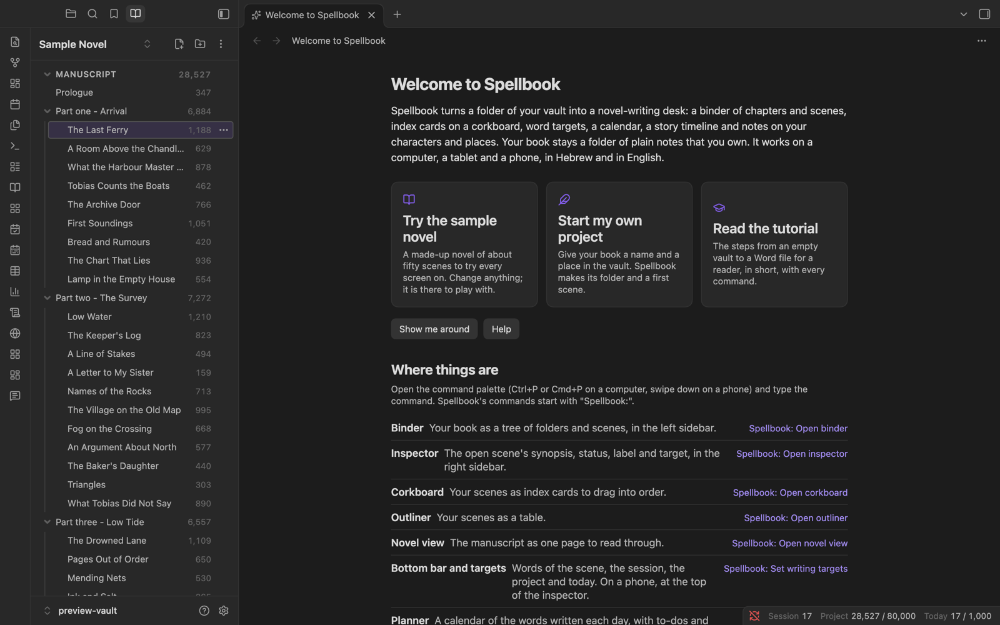

*The welcome page: three ways to begin, then the main screens with the command that opens each.*

**How to open it.** It opens by itself the first time Spellbook runs on a device whose vault has no Spellbook project: once per device, and never on a device whose vault already holds a project. On a phone or tablet it waits until Obsidian has finished reading the vault. To see it again, run **Open welcome page**, or press **Show** next to "Show the welcome page again" in Spellbook's settings.

**What you can do.** The page says in a paragraph what Spellbook is and offers three ways to begin: **Try the sample novel**, **Start my own project** and **Read the tutorial**. Under them, **Show me around** starts the tour and **Help** opens the Help pane. **Where things are** lists the main screens, each with the name of the command that opens it, to type in the command palette.

### The tour

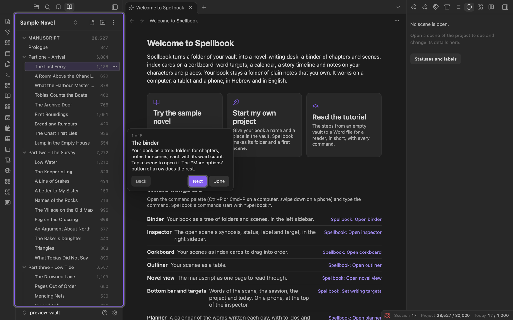

*The tour: a small bubble next to each main part of the screen in turn, here the binder.*

**How to open it.** **Show me around** on the welcome page, or the command **Show me around**.

**What it does.** It opens the binder and the inspector (not on a phone), then puts a small bubble next to each of the binder, the inspector, the bottom bar (on a phone, the word figures at the top of the inspector), the ribbon buttons and the command palette in turn, with **Back**, **Next** and **Done**. A part that is not on the screen is passed over. Press **Done** or Escape to end it; nothing is left behind.

### The Help pane

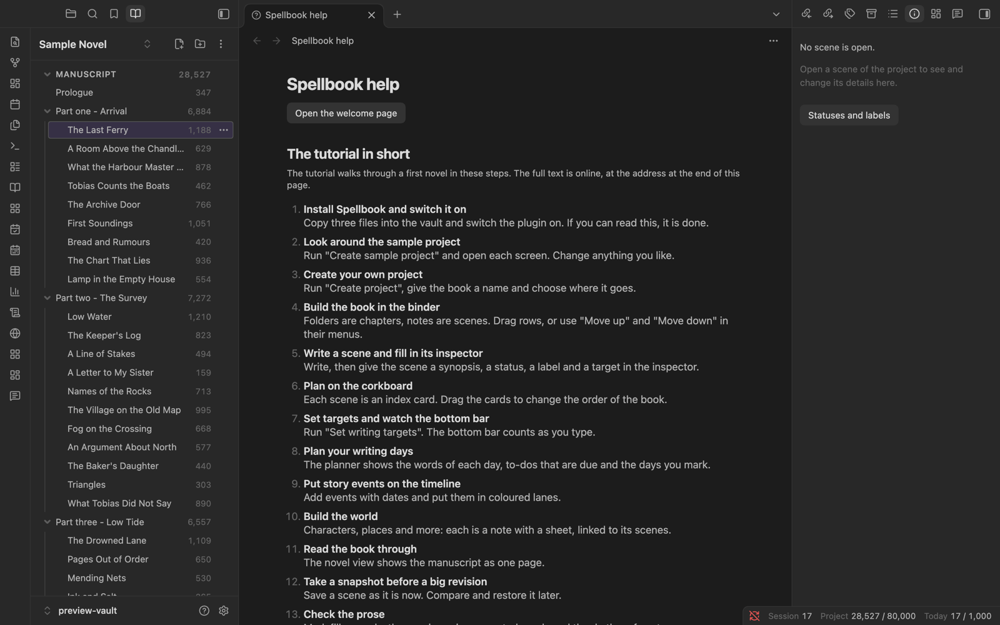

*The Help pane: the tutorial in short, then every command, then the addresses of the guide and the tutorial.*

**How to open it.** **Help** on the welcome page, or the command **Help**. It opens as a tab called "Spellbook help".

**What is in it.** **Open the welcome page**; **The tutorial in short**, the tutorial's steps in a line each; **Every command**, with what each does; and **The full guide**, the web addresses of this guide and the tutorial with a **Copy** button each. Spellbook never opens them itself: paste an address into your browser.

### What is new

After an update, a short note **What is new in** the new version shows once, with what changed. It is bundled in the plugin; nothing is fetched. Turn it off with "Show what is new after updates" in Spellbook's settings, and read it again with the command **Show what is new**.

**On a phone.** The tour does not open the sidebars, and points at the word figures at the top of the inspector instead of the bottom bar. The command palette opens with a swipe down.

**Limits.** Whether the welcome page and the note after an update have been shown is remembered on each device separately. The Help pane lists the commands of the version you have; the addresses lead to the newest guide online, which may describe a later version.

## Templates

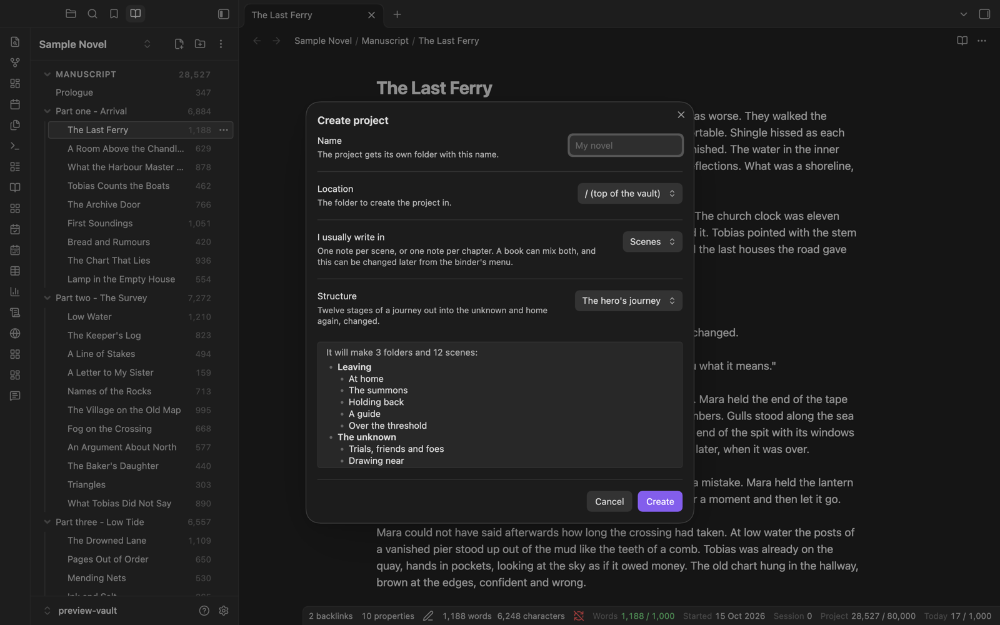

*Choosing a structure in the "Create project" window: the list below shows the folders and scenes it will make.*

**What it is for.** Not starting from nothing. A new project can start from a ready-made structure or from the shape of a project of your own, and a new scene or World entry can start from a template note.

**Structures for a new project.** In the **Create project** window, **Structure** offers:

| Structure | What it makes |
| --- | --- |
| **Blank** | One empty scene. |
| **Three acts** | Three folders (setup, struggle, resolution) with ten scenes. |
| **A fifteen-beat outline** | Three folders (Beginning, Middle, End) with fifteen scenes. |
| **The hero's journey** | Three folders (Leaving, The unknown, Coming home) with twelve scenes. |
| **Chapter by chapter** | One folder per chapter, each with a first scene. It asks how many **Chapters** (12 to begin with, at most 100). |

Each scene of a structure comes with a title and a synopsis that says what it is for; the scenes themselves are empty. Under the choice, the window lists the folders and scenes it will make. Project templates you saved yourself are offered in the same list, after the structures.

**Templates for new scenes and World entries.**

- **Save scene as template** (command, offered while a scene of the open project is in the editor) saves the scene's properties and text as a template. Give it a name and press **Save**. It goes in the project's `Templates/Scenes` folder.
- **Save as World template** does the same for the World entry in the editor. It goes in `Templates/World/` and the folder of the entry's type, and is offered for new entries of that type.
- From then on, the **New scene** window has a **Start from** list: **Empty scene** or one of your templates. **New character** and the other World commands have the same list: **Plain** or one of the type's templates.
- You can also write a template by hand: any note in those folders is one. In a template, `{{title}}` is replaced by the name of the new scene or entry, `{{date}}` by today's date (year-month-day) and `{{project}}` by the project's title. Any other word in double braces is left as it is.

**Templates for new projects.** **Save project as template** (command, offered while a project is open) opens a window with a **Name** (what "Create project" will call it), a **Description** (one line), and the switch **Include the text of the scenes**. Off, only the binder's folders and each scene's title and synopsis are saved. Press **Save**. The template is one note in the folder "Spellbook templates" at the top of the vault, and **Create project** offers it from then on, in this vault, in every project.

**The list of templates.** In Spellbook's settings, the section **Templates** lists **In this project** (the scene and World templates) and **For new projects**, each with **Open** and **Delete**. Delete asks first and moves the template's note to the trash; scenes, entries and projects made from it are not changed.

**On a phone.** It works the same. The **Create project** window lists the structure's folders and scenes in a box that scrolls.

**Limits.** Saving a template never replaces a note: a name already in use is refused. A template note is not a scene and not a World entry; it has no place in the binder, is not exported, and its words are not counted. The project templates' folder is the one thing Spellbook writes outside a project folder, and only when you run "Save project as template".

## Binder

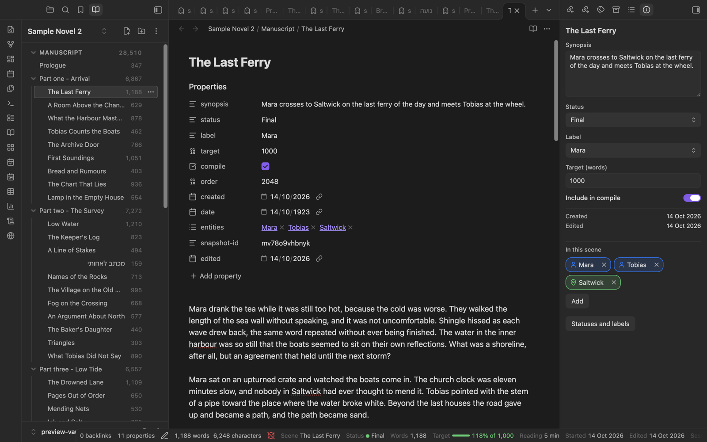

*The binder in the left sidebar, with a scene open in the editor and the inspector in the right sidebar.*

**What it is for.** The binder is the project as a tree: your scenes and folders in the order of the book.

**How to open it.** Command **Open binder**, or the ribbon button "Open Spellbook binder". It opens in the left sidebar. There is only ever one binder.

**What you see.**

- The project's name at the top. When the vault has more than one project, pressing it lets you choose another.
- A toolbar with **New scene** (or **New chapter**, see [Chapters or scenes, or both](#chapters-or-scenes-or-both)), **New folder** and a "More options" menu with **Collapse all**, **Expand all**, **I usually write in scenes**, **I usually write in chapters**, **Create project** and **Create sample project**.
- **Manuscript**: your scenes and folders. Each row shows its word count.
- **Unfiled**: notes that are in the Manuscript folder but not in the binder yet (for example, notes you made in Obsidian's own file list).
- **Research**: the notes in the Research folder.

**What you can do.**

- Tap a scene to open it.
- Every row has a "More options" button that opens its menu; a right-click opens the same menu.
  - A scene: **Rename**, **Move up**, **Move down**, **Move to folder**, **Treat as a chapter**, **Open in new tab**, **New scene below**, **Take snapshot**, **Snapshots**, **Delete scene**. On a chapter note the menu says **Treat as a scene**, **New chapter below** and **Delete chapter**.
  - A folder: **Show on corkboard**, **New scene inside**, **New folder inside**, **Rename**, **Move up**, **Move down**, **Move to folder**, **Remove folder (keeps scenes)**.
  - An unfiled note: **Add to manuscript**, **Open**, **Open in new tab**.
  - A scene whose note has gone missing: **Remove from binder**.
- Drag a scene or a folder to another place, or drag an unfiled note into the manuscript.
- With a keyboard: Up and Down go from row to row, Left and Right fold and unfold, Enter opens.

**Deleting.** "Delete scene" asks first, then takes the scene out of the binder and moves its note to the trash. Nothing is deleted outright.

**Renaming.** "Rename" on a scene renames its note, and Spellbook itself points every link to it at the new name: in the text and properties of your notes, and on idea boards (their note cards and the links in their text cards). A heading, a block, an embed and the text a link shows stay as they were. Obsidian is not asked to do it, so a rename never waits on its "Update links" question, whatever "Automatically update internal links" says in Obsidian's settings. The window says where links are changed: in this project only (as it comes), or in the whole vault, as you chose under "When a note is renamed, update links in" in Spellbook's settings (see [Settings](#settings)). With this project only, the window and a notice afterwards say how many notes outside the project still link to the old name. The same goes for renaming a board and a World entry. Renaming a binder folder changes only its name in the binder: binder folders are not folders on disk.

**Commands that act on the binder.** **New scene**, **New folder**, **Move scene up**, **Move scene down** and **Reveal active scene in binder** (shows the binder with the row of the note you are working on selected). They are only offered while they can do something.

**On a phone.** Long-press a row to pick it up and drag it. Everything a drag does, the row's menu does too.

**Limits.** If the project's index note cannot be understood, the binder says "This project is read-only" and changes nothing until the note is put right. If two devices changed the binder before syncing, a notice appears with **Merge** and **Dismiss**; see [Sync and several devices](#sync-and-several-devices).

## Chapters or scenes, or both

Some writers keep one note per scene and gather scenes into chapter folders. Others write a whole chapter in one note. Spellbook does both, in the same book if you like: some chapters as one note, others as a folder of scenes.

**Marking a note as a chapter.** Open a note's menu in the binder and choose **Treat as a chapter**. A small bookmark appears at the start of its row. **Treat as a scene** turns it back. Nothing in the note changes: the mark is kept in the project's index note, under `chapters`.

**What you usually write in.** Each project remembers whether you usually write in scenes or chapters. You choose it when you create the project, and can change it from the binder's "More options" menu (**I usually write in scenes** / **I usually write in chapters**). It decides what the toolbar's **New ...** button makes. A new note next to another one takes that note's kind, so **New scene below** a scene in a chapter folder makes another scene, even in a book written in chapters. Projects made before this choice existed write in scenes.

**What follows the kind.** The words on screen follow the note: **New chapter** or **New scene**, **In this chapter** or **In this scene** in the inspector, **Chapter** or **Scene** for the title in the bottom bar, "3 chapters and 2 scenes" on the corkboard and in Find and replace, and the first column of the plot grid. A chapter card on the corkboard says "Chapter" above its title. In the Novel view a chapter note has its title above it as a heading. Statuses, labels, targets, word counts, timeline dates, the plot grid, ages and snapshots work the same for both.

**Export.** A chapter note becomes a chapter of its own: its title is the chapter heading, it starts a new page, and it is listed in the contents, at the level a folder in the same place would have. A folder that holds chapter notes becomes a part heading above them (name it "Part One: The Spark", for example). Folders of scenes stay chapters as before, and scenes inside them are set apart by the scene break. This works in Word, the web page, the print page, the e-book and Markdown.

## Corkboard

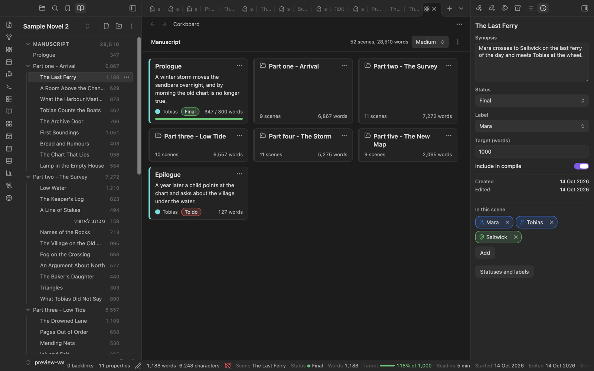

*The corkboard: one index card per scene, with its title, synopsis, status, coloured label and word count.*

**What it is for.** Seeing the shape of the book: each scene is an index card with its title, the start of its synopsis, its status, its coloured label and its word count.

**How to open it.** Command **Open corkboard**, the ribbon button "Open Spellbook corkboard", or **Show on corkboard** in a folder's menu in the binder. It opens as a tab in the main area.

**What you can do.**

- The board shows the whole manuscript or one folder. A folder is one card that stands for everything inside it; tap it to go into that folder. The trail at the top shows where you are, and each step of it can be tapped to go back up.
- Tap a scene card to open the scene.
- Drag a card to reorder it, or drop it onto a folder card to put it inside.
- Choose the card size: **Small**, **Medium** or **Large**.
- Each card has a "More options" menu: **Open**, **Open in new tab**, **Move earlier**, **Move later**, **Set status**, **Set label**, **Edit synopsis**.
- The board's own "More options" menu opens **Statuses and labels**.
- With a keyboard: the arrow keys go from card to card, Enter opens.

**On a phone.** Long-press a card to pick it up. "Move earlier" and "Move later" do the same without dragging. The number of columns follows the width of the pane.

**Limits.** The card size is remembered on each device separately.

## Inspector

**What it is for.** Seeing and changing the details of the scene that is open.

**How to open it.** Command **Open inspector**. It opens in the right sidebar. It has no ribbon button.

**What you can change.**

- **Synopsis**: a short summary of the scene.
- **Status** and **Label**: chosen from the project's lists. The **Statuses and labels** button opens the window that edits those lists.
- **Target (words)**: how many words the scene should come to. Leave it empty for no target.
- **Include in compile**: when this is off, the scene is left out of an export.
- **Created** and **Edited**: the dates the scene was started and last changed. Spellbook keeps these for you.
- **In this scene**: the characters, places, factions and items the scene involves. Press **Add** to choose from the world or to type a new name. Each one shows as a chip that can be taken out again. See [World](#world).

**On a phone.** A phone has no bottom bar, so the line of word figures (see [Word counts and the bottom bar](#word-counts-and-the-bottom-bar)) stands at the top of the inspector. The shortcut buttons you added to the bar stand there too, on a phone and on a tablet.

**Limits.** The inspector shows scenes of the open project only. For any other note it says "No scene is open."

## Statuses and labels

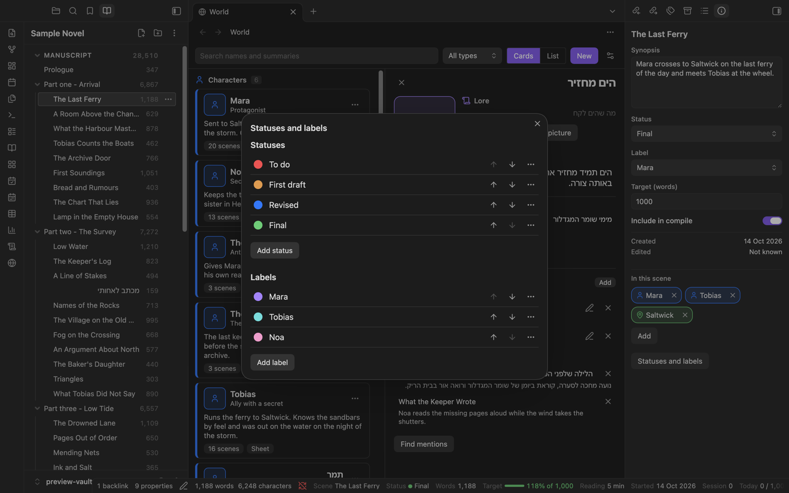

*The "Statuses and labels" window: each status and label has a colour, arrows to move it and a menu.*

**What it is for.** A status says how far along a scene is. A label is a colour of your own choosing, for a point-of-view character, a plot line or anything else.

**How to open it.** Command **Manage statuses and labels** (offered while a project is open), the **Statuses and labels** button in the inspector, or the corkboard's menu.

**What you can do.** A new project starts with the statuses To do, First draft, Revised and Final. In the window you can **Add status** and **Add label**, give each a colour, move them up and down, and **Rename**, **Change colour** or **Remove** them from each one's menu. Renaming a status or label changes it in the scenes that use it. Names used by scenes but missing from the list are shown under "Used by scenes, but not in the list" with an **Add** button.

## Outliner

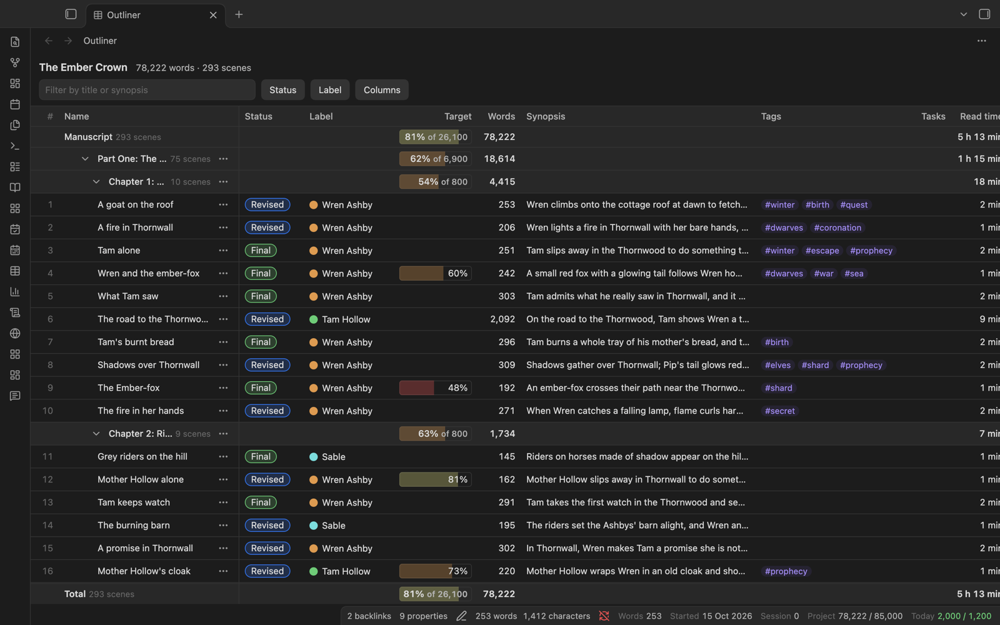

*The outliner: the manuscript as a table, with a row of totals for each folder and for the whole book.*

**What it is for.** The manuscript as a table, one row per scene under its folders, for checking and tidying many scenes at once.

**How to open it.** Command **Open outliner**, or the ribbon button "Open Spellbook outliner". It opens as a tab in the main area.

**The columns.** Name, Status, Label, Target, Words, Synopsis, Tags, Tasks, Read time, Compile, Created, Edited, and a row number. A first row sums up the whole manuscript, each folder sums up its scenes, and a **Total** row stands at the foot.

**What you can do.**

- Tap a Status or Label cell to change it, a Target or Synopsis cell to type in it, and the Compile box to switch a scene in or out of the export.
- Type in the box "Filter by title or synopsis", and use the **Status** and **Label** buttons to show only some scenes.
- Tap a column heading to sort by it; tap again to turn the sort round. A chip above the table says what the table is sorted by and clears it.
- The **Columns** button: show and hide columns, **Add property column** (a column for any property your scenes have), **Reorder columns**, **Reset columns**.
- A right-click on a column heading opens a menu for that one column: **Sort ascending**, **Sort descending**, **Clear sort**, **Hide column**, **Move earlier**, **Move later**.
- Each row has a "More options" menu: **Open**, **Open in new tab**, **Expand** or **Collapse** (folders), **Move up**, **Move down**.
- Drag a row to reorder it.

**On a phone.** A narrow pane shows a shorter list of columns. Long-press a row to pick it up; "Move up" and "Move down" do the same.

**Limits.** Tags come from a note's properties, not from #tags written in the text. Columns, sorting and filters are remembered on each device separately.

## Plot grid

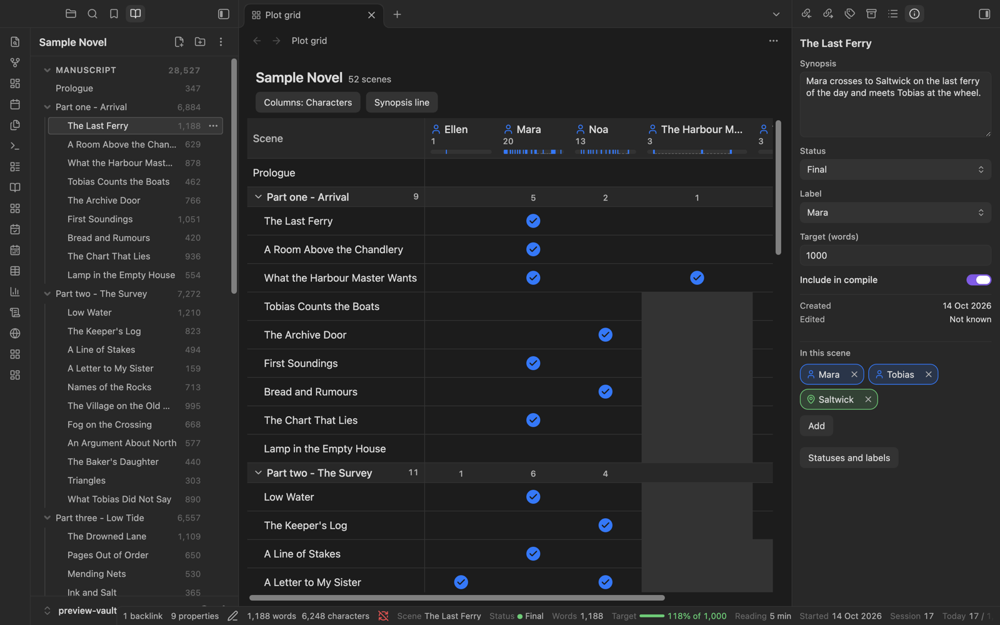

*The plot grid with a column for each character: a tick where the character is in the scene, and a grey stretch where one has been missing for a while.*

**What it is for.** Seeing which scene carries which plotline, and where a plotline or a character drops out of the book for too long.

**How to open it.** Command **Open plot grid**, or the ribbon button "Open Spellbook plot grid". It opens as a tab in the main area.

**What you see.** One row per scene, in binder order, under a row for each folder of the binder. One column per plotline. Each column's heading shows its name, how many scenes it is in, and a thin bar of where in the book those scenes are. A tick marks a scene that belongs to the column. A long run of scenes a column is missing from is shaded grey. A folder's row shows, for each column, how many of its scenes are in it.

**What the columns are.** Press **Columns** and choose:

| Columns | One column for each | A tick means the scene |
| --- | --- | --- |
| **Timeline lanes** | lane of the [timeline](#timeline) | is in that lane (its `timelines` property). |
| **Labels** | label (see [Statuses and labels](#statuses-and-labels)) | has that label. |
| **Characters** | character of the [World](#world) | lists that character under "In this scene". |
| **Places** | place of the World | lists that place under "In this scene". |
| **Chosen entities** | entity you pick | lists that entity under "In this scene". |

With **Chosen entities**, press **Choose** to open the "Choose entities" window, and tick the entities to follow; each becomes a column, the newest last. Press **Done**.

**What you can do.**

- Tap an empty cell to put the scene in that column, and a ticked cell to take it out. Each tap changes one property of one scene and nothing else. A scene has one label, so ticking another label moves the scene to it.
- Tap a scene's name to open it. With the middle mouse button, or Ctrl or Cmd held, it opens in a new tab.
- Tap a folder's arrow to fold it shut or open it again.
- **Synopsis line** shows each scene's synopsis on a line under its name. On a computer the synopsis also shows when the pointer rests on the name.
- A label that scenes use but that is missing from the project's list shows as a column with its name in italics.

**Settings** (under "Plot grid"): **Mark long gaps** says how many scenes in a row a column can be missing from before the stretch is shaded: any whole number from 2 to 99, 5 to begin with. 0 turns the shading off. **Shade before and after** (on to begin with) shades each column's cells before its first scene and after its last, so the stretch where that plotline, character or place is in the story stands out.

**On a phone.** The pane decides its layout by its own width. A narrow pane keeps the scene names in a narrower column at the side while the columns scroll sideways, with larger cells to tap.

**Limits.** The kind of columns, the chosen entities, the folded folders, the synopsis line, the gap length and the shading before and after are remembered on each device separately. Columns of characters and places only show entities of the built-in Character and Place types; use **Chosen entities** for any other. A read-only project, and a scene whose note is missing, show the grid but cannot be changed from it.

## Novel view

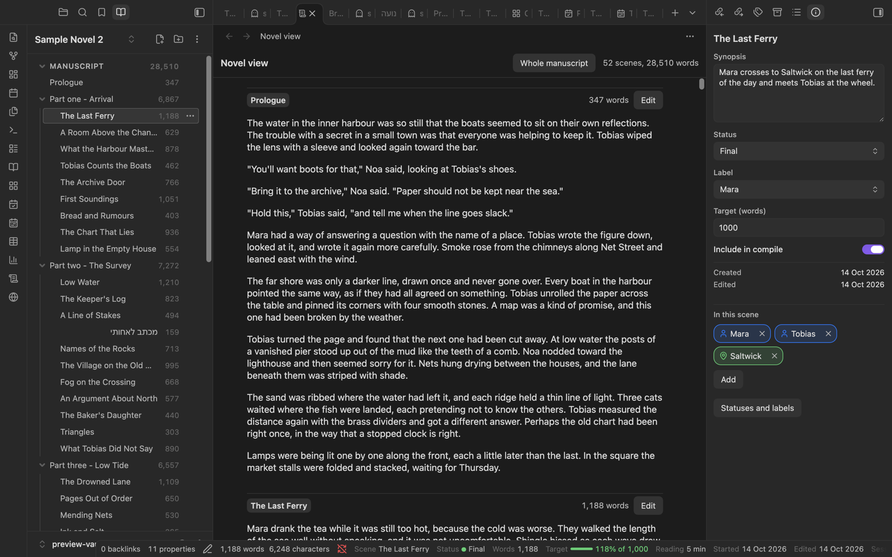

*The novel view: the scenes one after another as a single page, each under a small divider.*

**What it is for.** Reading the manuscript as one continuous page, scene after scene, each under a small divider with its title and word count.

**How to open it.** Command **Open novel view**, or the ribbon button "Open Spellbook novel view". It opens as a tab in the main area.

**What you can do.**

- Choose which scenes are shown: **Whole manuscript**, or one folder of the binder.
- Tap a paragraph, a scene's title or its **Edit** button. The scene's own note opens in Obsidian's editor at that paragraph. When you save, the novel view shows the change.
- The view remembers where you were reading.

**On a phone.** It works the same; the header is laid out for a narrow pane.

**Limits.** The novel view is for reading. You cannot type in it: Obsidian gives plugins no supported way to put a working editor for one note inside another screen. Tap to open the scene, and edit it there.

## Writing modes

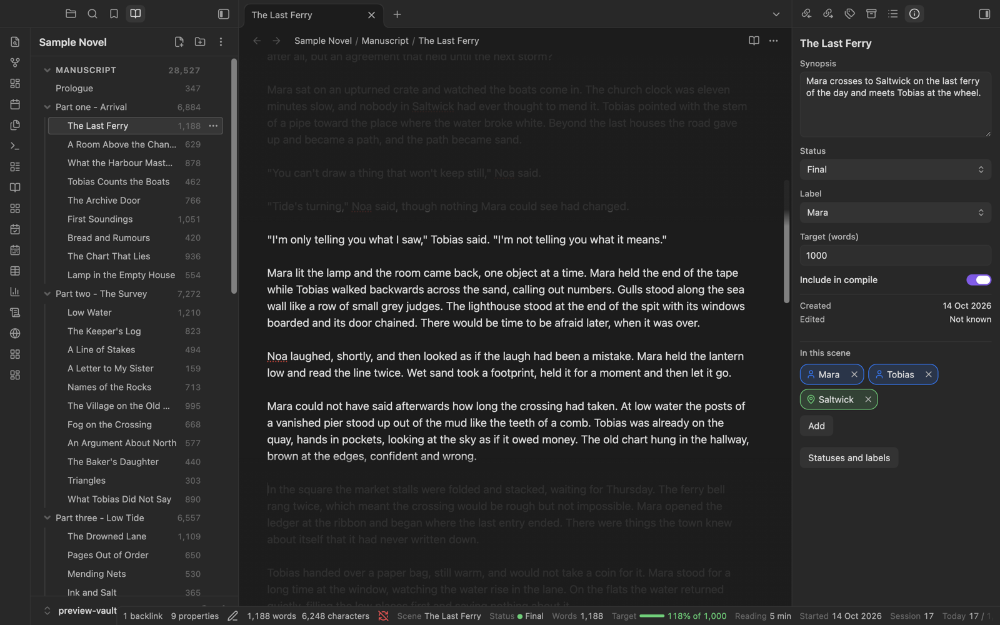

*Letter box mode: a band of lines stays lit, and the text above and below it is covered.*

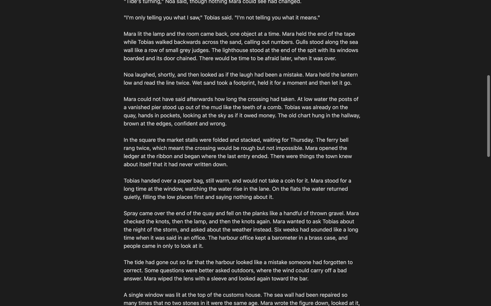

*Zen mode: the sidebars, the tabs and the bars are hidden, and only the text is left.*

**What they are for.** Four switches that change how the editor behaves while you write. They work in any note, not only in scenes, and can be on together.

**How to switch them.** Each has a command that turns it on and off:

| Mode | Command | What it does |
| --- | --- | --- |
| Zen | **Toggle Zen mode** | Hides the interface around the note. |
| Letter box | **Toggle letter box mode** | Covers the page except for a band of lines. |
| Typewriter | **Toggle typewriter mode** | Keeps the line you are writing at one height. |
| Hemingway | **Toggle Hemingway mode** | Refuses deleting, so that a draft only moves forward. |

**Leaving Zen.** Press Escape, or run the command again. While Hemingway mode is on, a lock is shown in the note's header (in the corner of the screen during Zen); press it to switch the mode off.

**Settings** (under "Writing modes"):

- **Letter box: height of the band** and **Letter box: text outside the band** (Hidden, Barely visible or Dimmed).
- **Typewriter: where the line rests**.
- **Zen: hide properties**, **Zen: hide the title** and **Zen: leave with Escape**.
- **Hemingway: allow undo**: Never, On phones and tablets only (the default), or Everywhere.

**On a phone.** A phone or tablet has no Escape key, so Zen shows a small "Leave Zen mode" button in the corner of the screen.

**Limits.** Which modes are on, and their settings, are remembered on each device separately. Typewriter scrolling while typing has not been watched on screen yet.

## Prose checks

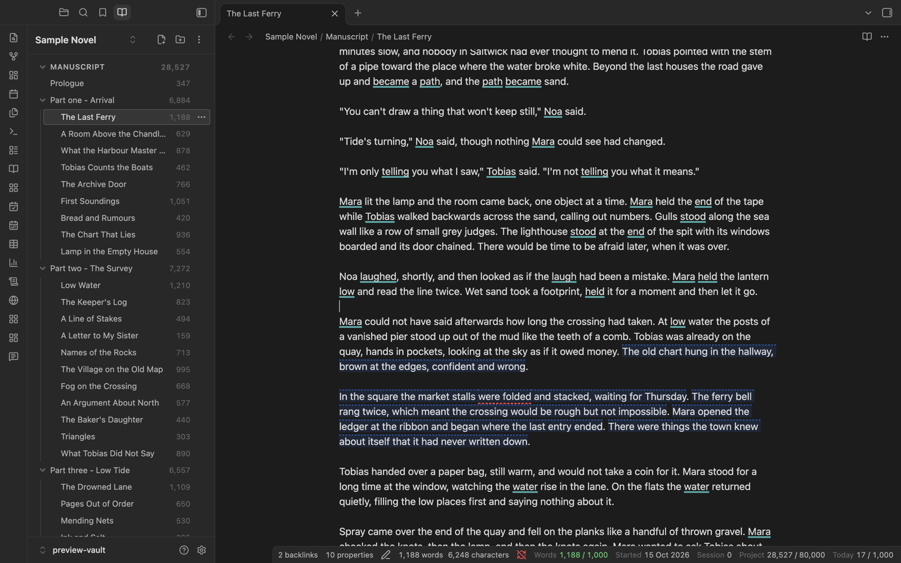

*Prose checks: marks in the editor on words and sentences worth a second look.*

**What they are for.** Marks in the editor that point at things worth a second look. They only change how the text looks, never the text itself. They show in the notes of Spellbook projects.

**How to switch them.** Everything is off until you switch it on. **Toggle prose checks** switches all of them on or off together; the first time, it turns on filler words, passive voice, repeated words, overused adverbs and sentence rhythm. Each check also has its own command:

| Check | Command | Languages |
| --- | --- | --- |
| Colour nouns | **Toggle prose check: colour nouns** | English |
| Colour verbs | **Toggle prose check: colour verbs** | English |
| Colour adjectives | **Toggle prose check: colour adjectives** | English |
| Colour adverbs | **Toggle prose check: colour adverbs** | English |
| Filler words | **Toggle prose check: filler words** | English and Hebrew |
| Passive voice | **Toggle prose check: passive voice** | English |
| Repeated words | **Toggle prose check: repeated words** | English and Hebrew |
| Overused adverbs | **Toggle prose check: overused adverbs** | English |
| Sentence rhythm | **Toggle prose check: sentence rhythm** | English and Hebrew |

**Settings** (under "Prose checks"): a switch for all the checks and one for each; **Repeated words: how close**; **Sentence rhythm: a long sentence**; **Your own filler words (English)** and **Your own filler words (Hebrew)**.

**On a phone.** The marks are worked out when typing pauses, so that the line being typed is not disturbed.

**Limits.** English word colouring is a best guess from word lists and endings: right about nine times in ten, worse in dialogue. In Hebrew, a repeated word counts as the same with or without the letters attached to its front, which gives an occasional false match. The small bubble that explains a mark has not been tried on screen. The choices are remembered on each device separately.

## Colour schemes

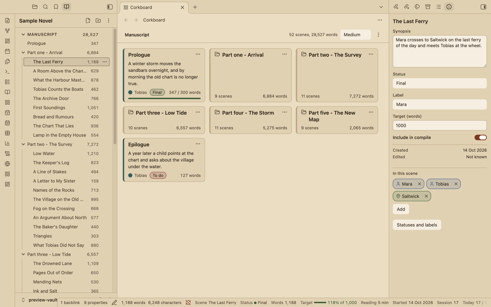

*The Sepia scheme, worn by the editor and by Spellbook's own screens.*

**What they are for.** Colours to write in. A scheme recolours the editor and Spellbook's own screens, on top of whatever Obsidian theme you use.

**How to choose one.** Command **Choose colour scheme** opens a list; **Next colour scheme** steps to the next one. They are also in the settings under "Colour scheme".

**The schemes.** Paper, Sepia and Mist are light. Dusk, Ink and Ember are dark. **None** gives everything back to your Obsidian theme.

**Limits.** A scheme keeps its own colours whether Obsidian is in light or dark mode. Pop-out windows are not recoloured. The choice is remembered on each device separately, so a phone and a computer can each have their own.

## Word counts and the bottom bar

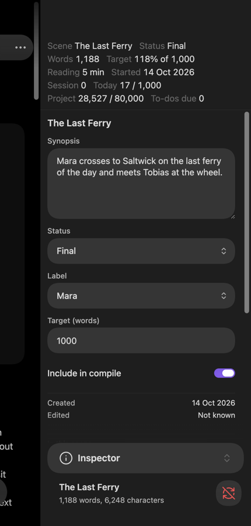

*On a phone, the figures of the bottom bar stand at the top of the inspector.*

**What it is for.** Spellbook counts the words you write and shows a line of figures for the open scene.

**Where it is.** On a computer or a tablet, in the bar at the bottom of the Obsidian window. On a phone, which has no bottom bar, at the top of the [inspector](#inspector). Shortcut buttons you add to the bar also show at the top of the inspector on a phone and on a tablet. Click a figure to open the [Writing targets](#writing-targets) window.

**The figures you can show.** Scene words, Scene target, Session words, Words today, Project words, Reading time, Date started, Date last edited, Status, To-dos due and Scene title. A new bar shows scene words, date started, date last edited, session, project and today.

**Settings** (under "Writing progress"):

- **Count pasted text**: when on, words you paste or drop in count as written and words you cut count as deleted. When off, only what you type counts.
- **Bottom bar**: move figures up and down, remove them, and **Add figure**.
- **Ready-made bars**: Minimal, Drafting and Everything.
- **Add button**: a shortcut button that runs any command you choose, for example one that switches a writing mode. Give it a label, an icon or both.
- **Reset to default**.

**How words are counted.** The same way on every device. A hyphenated word ("well-known", "e-mail") is one word, as in most writing programs. Words joined by a Hebrew maqaf (the short hyphen at the top of the line) count as two, since the maqaf joins separate words. Properties and `%% comments %%` are not counted. Reading time goes by 250 words a minute, in the bar, the outliner and the writing report alike. "This week" starts on the first day of the week of Obsidian's language, as the calendar does.

**The daily word log.** While you write, Spellbook keeps a log of the words added and deleted each day, split into the manuscript and other notes of the project. The calendar and the "today" figures are worked out from it. See [How your writing is stored](#how-your-writing-is-stored).

**Limits.** A long bar takes at most 60% of the window's width and scrolls sideways. Link addresses and code blocks count as words. The layout of the bar is remembered on each device separately.

## Writing targets

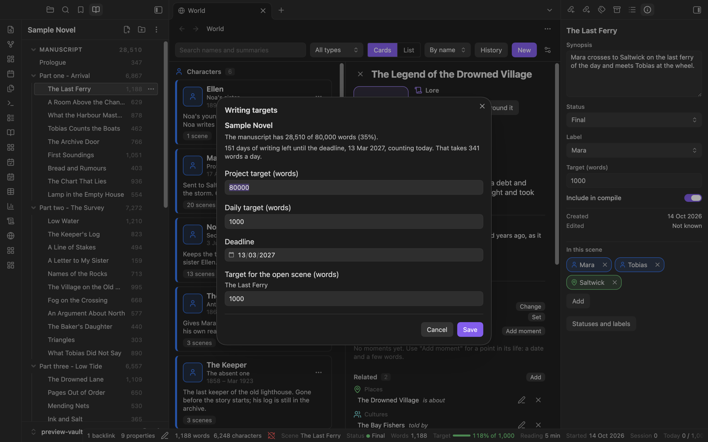

*The "Writing targets" window: how far the manuscript is, how many words a day the deadline takes, and the four targets.*

**What it is for.** Setting how much you mean to write.

**How to open it.** Command **Set writing targets**, or click a figure in the bottom bar.

**What you can set.** **Project target (words)**, **Daily target (words)**, a **Deadline**, and, when a scene is open, **Target for the open scene (words)**. Leave a field empty for no target. Press **Save**.

The targets show in the bottom bar, the outliner, the corkboard cards and the calendar.

## Planner: calendar and to-dos

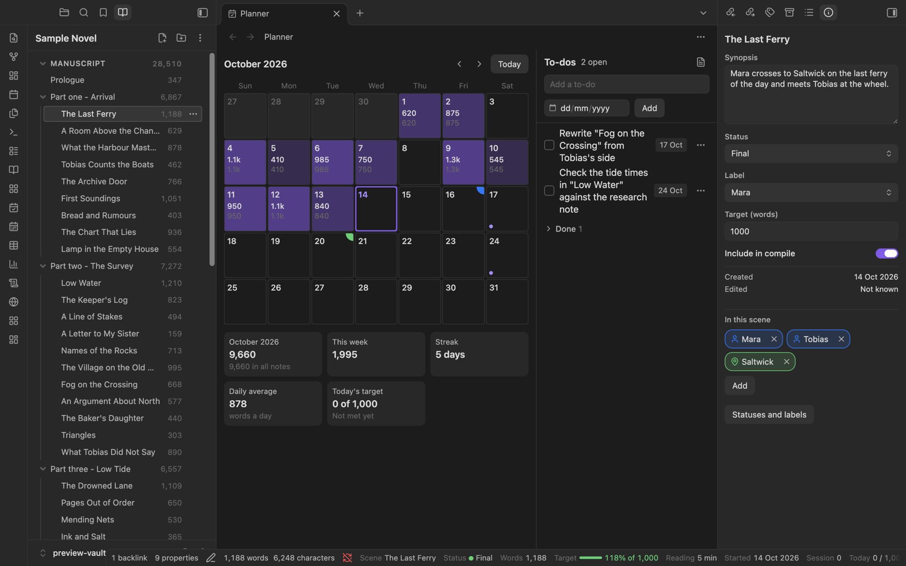

*The planner: the month, with words written, to-dos due and day marks, beside the to-do list.*

**What it is for.** One screen for the project's calendar and its to-do list.

**How to open it.** Command **Open planner**, or the ribbon button "Open Spellbook planner". It opens as a tab in the main area. The command **Open to-do note** opens the note the to-dos are kept in.

**The calendar.**

- A month at a time, with **Previous month**, **Next month** and **Today**.
- Each day is tinted by how many words you wrote, shows a dot for to-dos that are due, and shows its mark if you gave it one.
- It also shows the words of the month and of this week, your streak, your daily average and today's target.
- Choose a day to see **To-dos due**, to add a to-do for that day, and to **Mark** it with a colour and a short label. **Remove mark** takes the mark off.

**The to-do list.**

- Type in "Add a to-do", give it a due date if you like, and press **Add**.
- Tick a to-do to finish it. Finished ones move under **Done**.
- Each to-do has a menu: **Edit text**, **Set date**, **Clear date**, **Move up**, **Move down**, **Remove**.
- Drag a to-do to reorder it.

The to-dos are plain checkbox lines in `To-do.md`, which you can also edit by hand. A due date is written the way the Tasks community plugin writes it: a calendar emoji followed by the date as year-month-day.

**On a phone.** On a narrow pane the two halves become two tabs, **Calendar** and **To-dos**.

**Limits.** Only the due date is understood; other marks the Tasks plugin uses (start date, repeat rule, priority) are kept as part of the text.

## Writing report

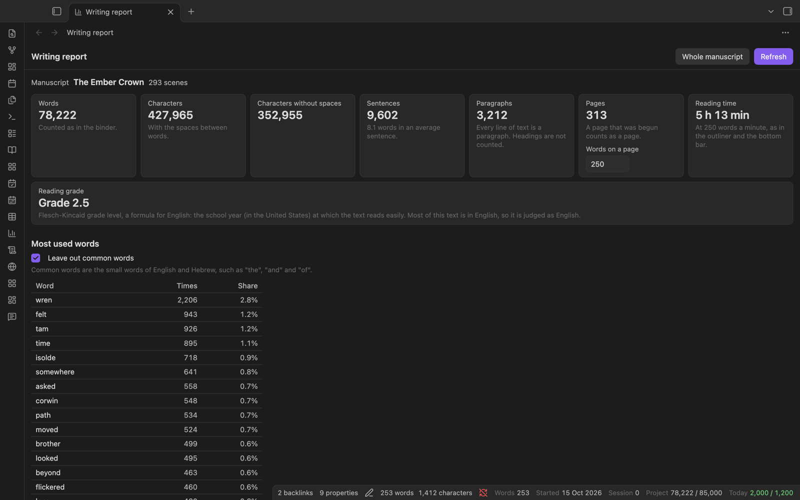

*The writing report for one scene: counts, pages, reading time, a reading grade and the most used words.*

**What it is for.** The figures of a piece of writing: words, characters with and without spaces, sentences, paragraphs, pages, reading time, a reading grade and the most used words.

**How to open it.** Command **Open writing report**, or the ribbon button "Open Spellbook writing report". It opens as a tab in the main area.

**What you can do.**

- Choose what the report is about: **The open scene**, a folder of the binder, or **Whole manuscript**.
- Press **Refresh** to work the figures out again. The report does not follow your typing; it tells you when its figures are out of date.
- Set **Words on a page** (under the pages figure) to change what counts as one page. It starts at 250. The same number can be set in Spellbook's settings, where the writing report has a row for it.
- Under **Most used words**, switch **Leave out common words** on or off, and press **Show more words** for a longer list.

**Limits.** Each line of text counts as one paragraph. For English the reading grade is the Flesch-Kincaid grade level. Hebrew has no such standard formula, so for Hebrew the report shows an approximate index (LIX) that is useful for comparing your own chapters with each other, not as a school year. Whole-manuscript and Hebrew reports have not been looked at on screen.

## Timeline

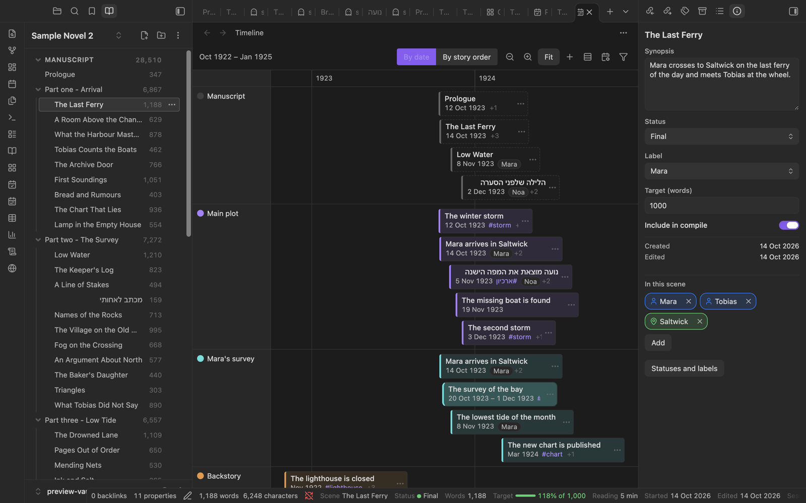

*The timeline: named, coloured lanes on one time axis, with events as cards.*

**What it is for.** Laying the story out in time: several named, coloured lanes on one time axis.

**How to open it.** Command **Open timeline**, or the ribbon button "Open Spellbook timeline". It opens as a tab in the main area.

**How it works.**

- An **event** is a note in the project's Timeline folder with a date. An event with an end date is a span; one without is a point. Events show as cards with their title and tags.
- A **lane** is a named, coloured row, for example one per plot line. An event can show in several lanes.
- Two lanes are built in: **Manuscript** shows the scenes that have a date, and **Other** shows events that name no listed lane.
- Events without a date wait in the **Undated** strip, each with a **Set date** button.

**What you can do.**

- **By date** and **By story order** switch between the order things happened in and the order the book tells them in.
- **Zoom out**, **Zoom in** and **Fit**.
- **New event**, or tap a lane to add an event there.
- Drag an event along the axis to change its date.
- Each event has a menu: **Open**, **Open in new tab**, **Set date** or **Change date**, **Move earlier**, **Move later**, **Entities**, **Move to lane**, **Also show in lane**, **Remove from this lane** (not offered for a scene in the Manuscript lane, where scenes always stay).
- **Lanes** opens the "Timeline lanes" window: **Add lane**, and for each lane **Rename**, **Colour**, **Move up**, **Move down**, **Remove**, and **Hide** or **Show**. Removing a lane keeps its events; they show in the Other lane.
- **Calendar** opens the [story calendar](#story-calendar).
- **Only events with** narrows the timeline to the events that involve chosen characters, places or other entities; **Show all events** undoes it. It narrows the world lanes too.
- **Filter by tags** (the tag button) shows only what carries chosen tags: events (their `tags`), scenes (their `tags`) and entities (the `tags` of their note). Pick tags from those used in the project, each shown with how many things carry it. **Any tag** shows what has one of them, **All tags** what has every one; a tag also matches the tags nested under it, so `royalty` matches `royalty/king`. Under **Show only**, tick kinds to see just those, for example Characters and Events; ticking a type of entity turns the world lanes on. A "Filtered: ..." strip says what is shown; tap it to change the filter, or **Clear filter** to see everything. Lanes the filter leaves empty are not drawn. So a king who is a character tagged `royalty` shows on his lane beside the royal events.
- **Views** (the first button, named after the view shown, with "(filtered)" after the name while a filter by tags that no saved view holds is on) switches between saved combinations of lanes shown or hidden, world lanes on or off, and the filter. Two are built in: **Story** (the manuscript and your lanes, no world lanes, no filter) and **World history** (the world lanes and the events, the Manuscript lane hidden). Neither touches a lane you hid yourself. **Save current view...** keeps what you see under a name; saving under the same name again replaces it, and each saved view has a **Delete** item.
- **World** switches the world lanes on or off: one lane for each type of entity that has a date, after your own lanes. An entity with a date and an end is a bar between the two; one with only a date is a point; its moments are small points on the same row, and its name stands on it. Tap an entity to open its sheet in the World screen; its menu has **Open sheet**, **Open note**, **Open note in new tab**, **Move earlier** and **Move later**. Drag it along its lane to change its dates, as you would an event; it stays in the lane of its type. In the "Timeline lanes" window the part called **World** shows or hides all world lanes, and each type's lane on its own.

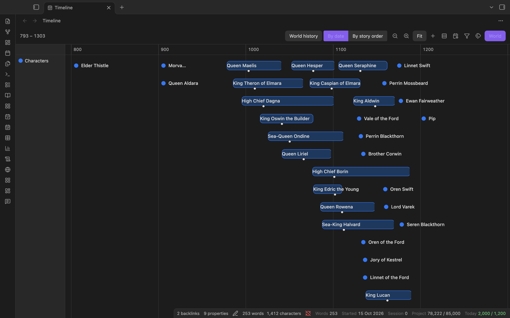

*World history: the sample novel's characters and places on the timeline, from the drowned village of the 1600s to the story's 1923.*

**World history.** Command **Open world history**, or the **History** button in the World screen, switches the timeline to the **World history** view, fitted to the range of the world's dates. To get the scenes back, choose **Story** under **Views**, or turn **World** off. The world lanes show in **By date** order only.

**Dates.** A date can be a year, a year and month, or a full date: 1923, 1923-04 or 1923-04-12.

**On a phone.** A narrow pane shows one lane at a time, with time running from top to bottom and a row of buttons to switch lane. Slide with one finger to move along the timeline and pinch with two to zoom. Rest a finger on an event to pick it up; "Move earlier" and "Move later" do the same without dragging.

**Limits.** Which lanes are hidden, the filter by tags and the saved views are remembered on each device separately. The filter reads tags from the `tags` property only, not from tags written in a note's text. A narrow card shows as many whole entity chips as fit, then a "+N" chip for the rest.

## Story calendar

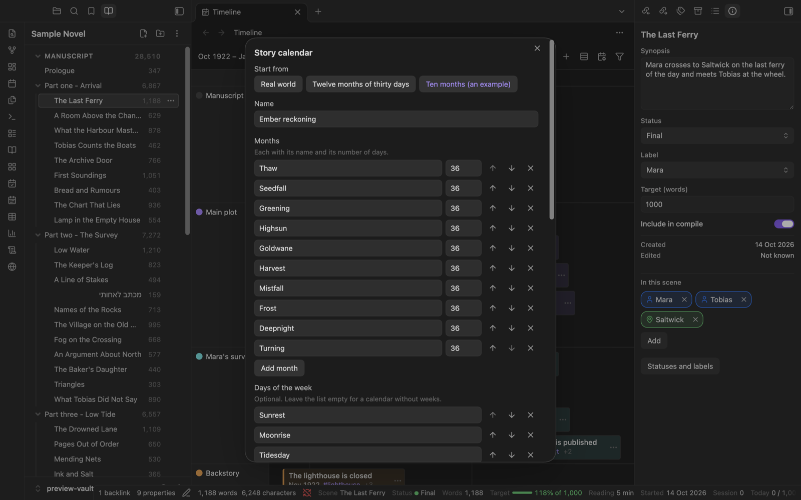

*The "Story calendar" window, started from the ten-month example: months with their lengths, then the days of the week.*

**What it is for.** A story set in an invented world can have its own calendar, and the timeline then counts in it.

**How to open it.** Command **Edit story calendar**, or the **Calendar** button on the timeline. The window is called "Story calendar".

**What you can set.** Under **Start from**, choose the real-world calendar or a ready-made one such as "Twelve months of thirty days", then make it your own: a **Name**; the **Months**, each with its name and number of days; the **Days of the week** (optional); the **Eras**, each with a name, a short form and the year it begins; **An era before the first**; **Year zero**; and **Leap years**. Press **Use this calendar**.

**Limits.** Switching calendar changes no note. Dates that do not fit the new calendar show as undated until you set them again; the window lists them first and asks you to press **Use it anyway**. Dates sort correctly only within one era. The date pickers in the event window have not been tried on screen.

## World

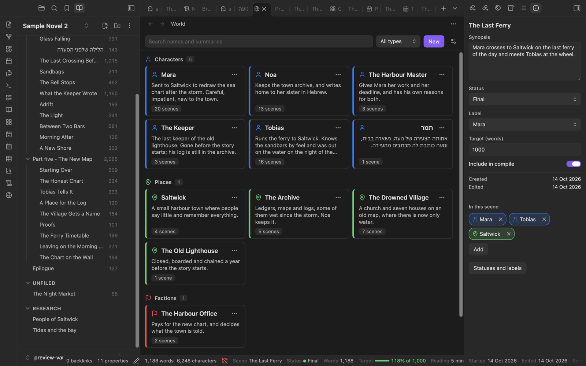

*The World screen as cards: one for each entity, in a group for each type.*

**What it is for.** Keeping track of who and what is in the story's world, how they have to do with each other, and which scenes and events they are in.

**What is in it.** Each thing in the world is an **entity**: a plain note in the project's World folder. Seven types are built in:

| Type | For | Starts with these fields |
| --- | --- | --- |
| Character | The people of the story. | role, age, occupation, appearance, personality, voice, goal, arc, summary |
| Place | Towns, houses, countries. | kind, region, atmosphere, landmarks, summary |
| Faction | Groups, families, offices, armies. | kind, leader, summary |
| Item | Things that matter to the plot. | kind, owner, summary |
| Lore | Legends, tales, myths, history, religion, customs. | kind, period, told-by, summary |
| Creature | Animals and beings. | kind, habitat, summary |
| Culture | Peoples and their languages. | kind, region, summary |

You can change these and add types of your own: see [Entity types of your own](customising.md#entity-types-of-your-own).

**In Obsidian's graph.** The entities of a scene are ordinary Obsidian links, so Obsidian's graph view and backlinks show who appears where. [Customising: the story graph](customising.md#the-story-graph) shows how to colour it by kind of note.

**How to open it.** Command **Open world**, or the ribbon button "Open Spellbook world". It opens as a tab in the main area.

**Adding to the world.** Commands **New character**, **New place**, **New faction**, **New item**, **New lore**, **New creature**, **New culture**, and **New entity** (which asks what it is). The **New** button in the World screen does the same. Each one becomes a plain note in the World folder, in a folder for its type, with the type's fields empty and a few headings to write under.

### Cards and list

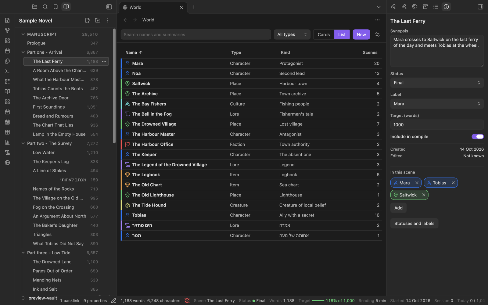

*The World screen as a list: tap a column's heading to sort by it.*

At the top of the screen:

- A search box, which looks in names, other names and summaries.
- **All types**, to show one type only.
- **Cards** and **List**, under "Show as". Cards show each entity's picture or icon, its name, one or two key facts and its summary, in a group for each type. The list is one table of them all with the columns **Name**, **Type**, **Kind**, **From**, **Until** and **Scenes**; tap a heading to sort by it, and again to turn the order round. **From** and **Until** are when each entity begins and ends.
- **By name** or **By date**, for the order of the cards in each group. By date, the earliest comes first and those without a date come after. A card shows its dates under its key facts.
- **History**, which opens the [world history](#timeline) on the timeline.
- The **Story's present** button (a calendar with a clock), which sets the date the characters' ages are worked out at. See [Ages](#ages).

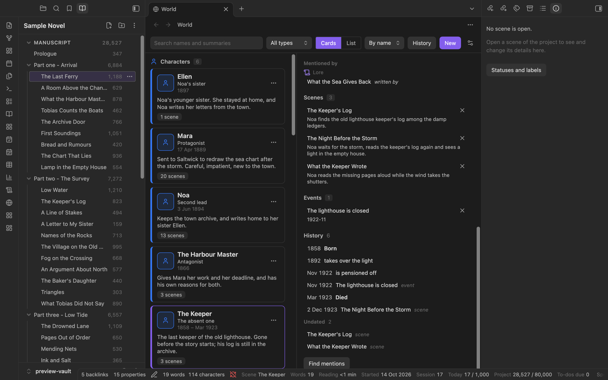

*The History part of a sheet: everything dated about the Keeper, in order, with the event and scene it belongs to.*

- **New**, and the button for **Entity types**.

Tap a card, anywhere on it, its name included, to open the entity's sheet; the number of scenes on the card does the same. In the list it is the same: tap a row to open the sheet. The sheet's **Open note** opens the note itself. On a computer, Cmd-click (Ctrl-click on Windows and Linux) or a middle click on a card or a row opens the note in a new tab. With a keyboard, Enter on a card or a row opens the sheet. Each card has a menu: **Open note**, **Open note in new tab**, **Open sheet**, **Rename**, **Delete** (to the trash).

### The entity sheet

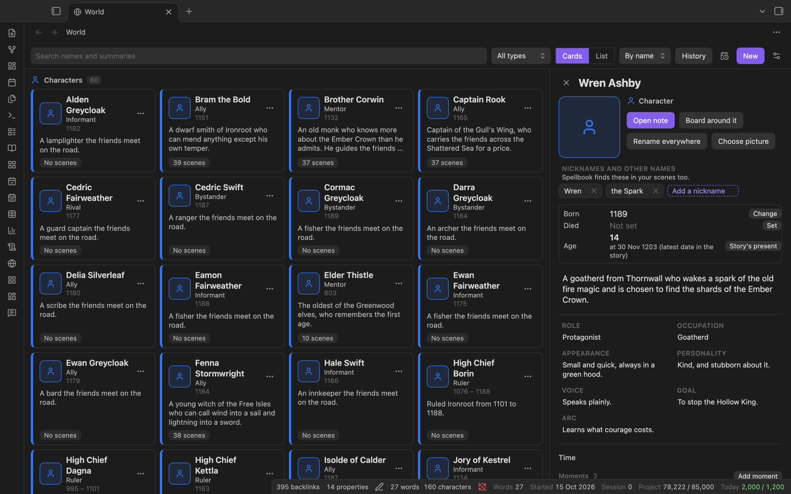

*A character's sheet beside the cards: the picture, the summary, the fields, then Related and Scenes.*

The sheet is one entity laid out to read and to fill in. It opens beside the list in a wide pane. The command **Open entity sheet** opens the sheet of the entity whose note is open in the editor.

- **Picture.** **Choose picture** lists the image files in your vault; tap one. **Remove picture** takes it off again. The picture file itself is never moved or changed. An entity without a picture shows its type's icon.
- **Nicknames and other names.** Straight under the picture, for every type. See below.
- **Born, Died and Age.** On a character's sheet, right after the other names. See [Ages](#ages).
- **Summary and fields.** Type in a field and press Enter, or tap elsewhere, to save it. Each field is one property of the note; the note's text is never touched. A property that holds a list is shown but is changed in the note itself.
- **Open note** opens the note, where you write as much as you like under its headings.
- **Related.** Press **Add**, type how the two have to do with each other ("sister", "keeps", "born there"; you may leave it empty), and tap the other entity. Relations are grouped by type. Each has a button to change its label and one to remove it. A relation is written in one note only; the other entity's sheet shows it by itself under **Mentioned by**.
- **Scenes.** The scenes the entity is in, in the order of the book, each with its synopsis and a button to take the entity out of that scene. For a character, a scene with a date shows the character's age then.
- **Time.** When the entity begins and when it ends (for a character these are at the top of the sheet instead), under its type's own words: a character is **Born** and **Died**, a place **Founded** and **Abandoned**, a faction **Founded** and **Dissolved**, an item **Made** and **Lost**, lore **Set in** and **Until**, a creature or a culture **First known** and **Last known**; a type of your own says **From** and **Until**. Press **Set** or **Change** and give the date in the same fields as the timeline's event window (in an invented calendar you pick the era, year, month and day); **Remove** takes the date away. Under **Moments**, **Add moment** adds a point in the entity's life: a date and a few words, such as "comes to Saltwick". Each moment can be changed or removed. Each change saves one property of the note and nothing else.
- **Events.** The timeline events that list it, each with its date in the story.
- **History.** Everything dated that concerns the entity, in order of time: its own dates and moments, the timeline events that list it and the dated scenes it is in. Tap a line to open the note it comes from. Whatever has no date is listed after, under **Undated**.
- **Find mentions.** Lists scenes whose text names the entity, or one of its other names, without listing it, each with a **Link this scene** button.

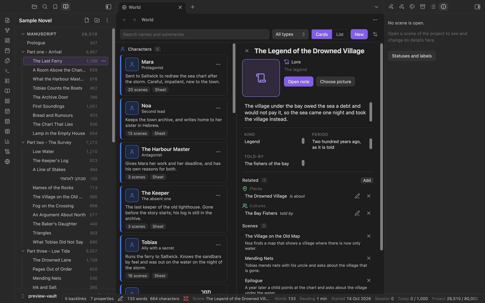

*The sheet of a legend: its kind, its period, who tells it, and the scenes and events it touches.*

**Nicknames and other names.** Straight under the name and the picture, before the summary and the fields, **Nicknames and other names** lists what else the entity is called: a character's nickname, a title, a short name, the name in another language. It is there for every type, on a phone as well. Each name is in a small box of its own. Type in **Add a nickname** and press Enter, or tap elsewhere, to add one; tap a name to change it; press the button beside a name, or empty its box, to remove it. They are saved as Obsidian's own `aliases` property of the note, as a list, so Obsidian's links and search know them as well, and "Find mentions" looks for them too. A Hebrew name reads right to left in its box.

### Ages

Give a character a **Born** date and Spellbook works out the age; nothing has to be typed.

- **Age** sits under **Born** and **Died** near the top of the sheet. With a death date it says, for example, **Died at 63**. Without one it gives the age at the **story's present**, and says which date that is.
- **The story's present** is the latest date of any scene or timeline event, shown as "(latest date in the story)", until you set one. Set it with the **Story's present** button at the top of the World screen, or the one beside the age; leave the date empty, or press **Remove**, to go back to the latest date. It is kept in the project's index note, so it syncs with the project.
- **In a scene.** When a scene has a date, its characters' ages at that date show on the inspector's chips under **In this scene** (for example "Wren · 14") and in the sheet's list of scenes. A character who is not born yet, or already dead, at the scene's date gets a small warning mark instead; hold the pointer over it, or read the sheet's list of scenes, to see which: "not born yet in this scene" or "died before this scene".
- **The typed age.** The character's **age** field stays as it was while there is no Born date. Once there is, a typed age that says the same as the worked-out age (or nothing) is hidden, and one that says something else ("about forty") is shown as **Age (typed)**.
- **Calendars.** Ages work in an invented calendar too, counted in its own years. When a date gives only the year, the age counts whole years; the month and day count when both dates give them.
- **Which types.** Characters always have an age. Any other type has one when its date words begin with "Born": for example, give creatures the date words "Born, Died" in **Entity types**. A place that is **Founded** has no age.

**Linking to scenes and events.** In the [inspector](#inspector), under **In this scene**, press **Add**. On the timeline, use **Entities** in an event's menu.

**Entity types.** The **Entity types** window lets you **Add a type** of your own (for example "Spell") and **Rename**, **Change folder**, **Change properties** or **Change date words** of any type, or **Remove** one of your own. **Change date words** takes two words with a comma between them, for example "Launched, Wrecked"; leave it empty for the usual words. Changing a type never changes a note.

**On a phone.** A narrow pane shows one column of cards, and the sheet takes the place of the list, with a button that leads back.

**Limits.** Cards or list is remembered on each device separately. A picture must already be a file in the vault. If two projects in one vault have an entity with the same name, Spellbook's own screens lead to the right project's note, but a click on the link in Obsidian's Properties panel may still open the other one. Rename, delete, "Find mentions" and types of your own have not been tried on screen.

## Idea boards

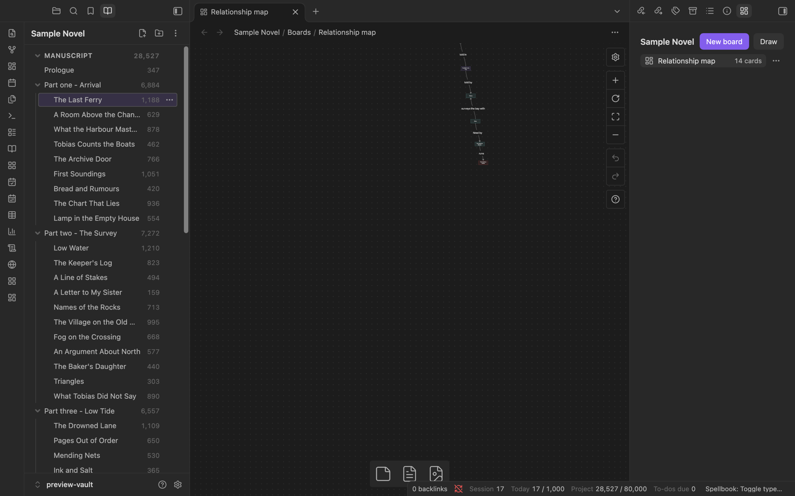

*The Idea boards pane in the right sidebar: each board of the project with the number of cards on it.*

**What it is for.** A free surface for loose ideas: notes, scraps and arrows that do not yet belong anywhere in the binder. Spellbook can also lay out a board for you from the World or from the binder.

**What a board is.** An Obsidian Canvas file in the project's Boards folder. It opens in Obsidian's own Canvas, on a computer, an iPhone and an iPad, and stays usable without Spellbook. You add, move, colour and join cards with Canvas's own tools.

**How to open it.** Command **Open idea boards**, or the ribbon button "Open Spellbook idea boards", shows the **Idea boards** pane in the right sidebar. Command **New idea board** asks for a **Name** and makes an empty board.

**What you can do in the pane.**

- **New board**: the same as the command.
- **Draw**: a menu of the three boards Spellbook lays out for you, **Relationship map**, **Chapter as cards** and **Around an entity** (see below).
- Tap a board to open it. Its "More options" menu, or a right-click, has **Open**, **Open in new tab**, **Turn cards into notes**, **Rename** and **Delete**. Delete asks first and moves the board to the trash; the notes its cards show stay where they are.

**Turning cards into notes.** Command **Turn board cards into notes** (for the board that is open, or one you pick), or **Turn cards into notes** in a board's menu. The window lists the board's text cards. For each, choose **Leave as a card**, **Scene** or a World type; **All scenes** and **Leave all** choose for every card at once. **New scenes go to** says which folder of the binder new scenes go in. Press **Make notes**. The first line of a card becomes the title; the rest becomes the synopsis of a scene or the summary of a World entry. On the board, each card is then replaced, in the same place, by a card that shows the new note.

A board that is drawn again is a new board: drawing never changes one you already have. A second one of the same name gets a number, for example "Relationship map 2".

### Relationship map

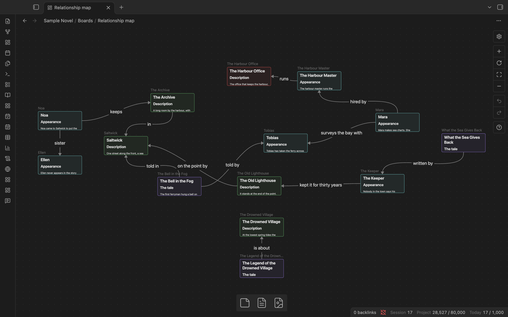

*A relationship map of the sample novel: each entity a card in its type's colour, each relation a labelled arrow.*

Command **Board: relationship map**, or **Draw** then **Relationship map** in the pane. The window asks which types of entity go on the map, with a switch for each (characters to begin with). Press **Draw board**. Each entity becomes a card that shows its note, in its type's colour, and each relation between two of them becomes one arrow, labelled as the World says ("sister", "keeps"). Relations are made on an entity's sheet; see [The entity sheet](#the-entity-sheet).

### Chapter as cards

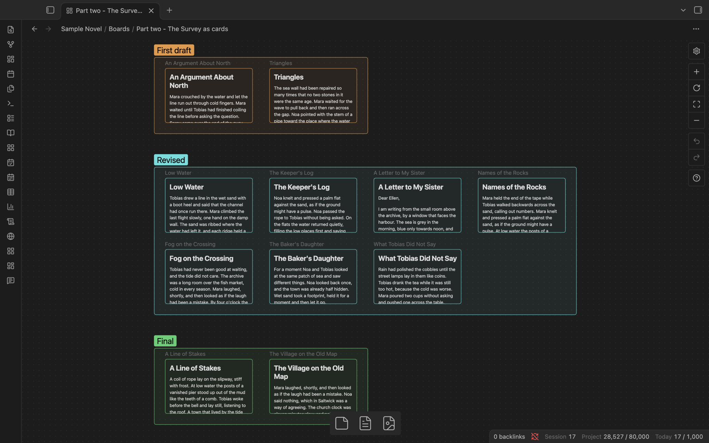

*Part one of the sample novel as cards, grouped by status: a box for "Revised" and one for "Final".*

Command **Board: chapter as cards**, or **Draw** then **Chapter as cards**. Choose **Scenes from** (**Whole manuscript** or a folder) and **Group by** (**Status**, **Label** or **No grouping**), and press **Draw board**. Each scene becomes a card that shows its note, in reading order, four to a row; with grouping, each status or label is a labelled box of its own, and scenes without one come last. Moving the cards on the board does not change the order of the book.

### Around an entity

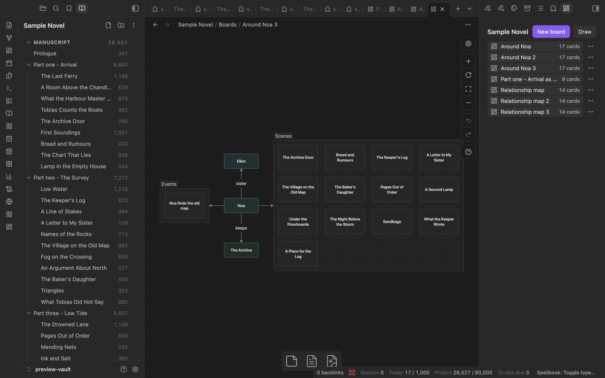

*A board around Noa: her relations above and below, her events on one side and her scenes on the other.*

Command **Board: around this entity** (for the World entry open in the editor, or one you pick from a list), **Draw** then **Around an entity**, or the **Board around it** button on an entity's sheet in the World screen. The entity's card stands in the middle; the entities it has to do with stand round it with labelled arrows; its scenes and its timeline events stand in two boxes beside it, **Scenes** and **Events**.

**On a phone.** The pane opens in the right-hand drawer. Opening a board slides the drawers away so that the board can be seen. Boards are edited with Obsidian's Canvas, as it works on a phone.

**Limits.** Obsidian gives plugins no supported way to add to a card's own menu on a Canvas, so "turn into a note" is a command and an entry in the pane's menu, not an entry on the card. Canvas has six colours: a blue status, label or type is drawn as cyan, and pink as purple. A drawn board is a picture of the moment it was drawn: it does not follow later changes to the World or the binder; draw it again for a fresh one. Boards have been looked at on a Mac only, not in Canvas on an iPhone or iPad.

## Snapshots

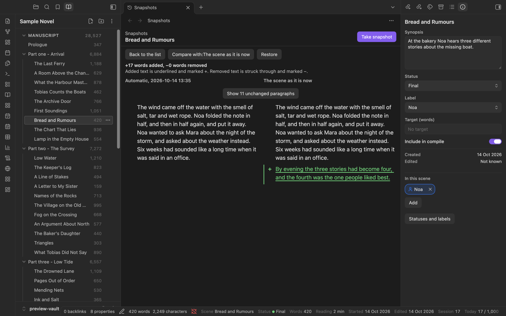

*Comparing a snapshot with the scene as it is now: added text is underlined, removed text is struck through.*

**What they are for.** A snapshot is a saved version of one scene, so that you can revise without fear.

**How to use them.**

- **Take snapshot** (command, the binder's scene menu, or the button in the Snapshots screen) saves the open scene as it is now. You can give it a name or leave the name empty.
- **Snapshots of this scene** (command, or **Snapshots** in the binder's scene menu) opens the Snapshots screen for that scene, as a tab in the main area. It has no ribbon button.

**What you can do in the Snapshots screen.** The scene's snapshots are listed newest first, with name, date, word count and how many words differ from the scene now. For each:

- **View** shows its text.
- **Compare** sets it against the scene as it is now or against another snapshot. Added text is underlined and marked with a plus; removed text is struck through and marked with a minus.
- **Restore** replaces the scene's text with the snapshot's. It asks first, and it always saves the text as it is now as a snapshot of its own, called "Before restore", so you can go back. The scene keeps its current status, label, synopsis and other properties unless you tick **Also restore properties**.
- **Delete** moves the snapshot to the trash. The scene is not touched.

**Automatic snapshots.** In the settings under "Snapshots", **Take a snapshot before the first edit of the day** saves a scene as it was the first time you change it each day. It is off unless you switch it on. **Automatic snapshots to keep for a scene** (10 to begin with) sets how many are kept; older automatic ones go to the trash. Snapshots you took yourself are never removed for you.

**On a phone.** A comparison is shown in one column instead of side by side.

**Limits.** The first snapshot of a scene writes a `snapshot-id` property into that scene, so that its snapshots follow it when it is renamed. Deleting a scene leaves its snapshots in place. Automatic snapshots have not been tried on screen.

## Revision

**What it is for.** Tools for the rewriting, once a draft is down: notes pinned to the passages you want to come back to, one list of all of them, finding and replacing words across the whole manuscript, and renaming a character or a place everywhere at once.

**Notes on a passage.**

- Select some words in a scene and run **Add revision note** (command, or the editor's right-click menu; on a phone or tablet, the menu that opens when you press and hold a selection). A small window shows the words you chose; type your note and press **Add note**. Ctrl+Enter or Cmd+Enter saves too.
- The words stay exactly as they are: the note is not kept in the scene at all, but in one file of the project's own, "Revision notes.json" at the top of the project folder. Obsidian does not list it, and you never need to open it. A note follows its scene when you rename or move the scene; if you delete the scene, its notes are kept, and come back if you put the scene back under its name. In the editor, passages with an open note get a light dotted underline. Point at one, or tap it, to read its note.
- When you rewrite a passage so that its exact words are no longer in the scene, its note stays, and the Revision pane marks it **Passage changed**.

**The Revision pane.** **Open revision notes** (command, or the ribbon button "Open Spellbook revision notes") shows the pane in the right sidebar. It lists the notes of the whole manuscript, grouped by scene in binder order.

- **Open**, **Done** and **All** choose which notes are shown; the list beside them narrows it to one binder folder.
- Tap a scene's title to open the scene; tap a quoted passage to open the scene with those words selected.
- Tick **Done** when you have dealt with a note. **Edit** changes its words; **Delete** takes it away (it asks first). Neither touches the scene's text.

**Find and replace.** **Find and replace in the manuscript** (command, or the button at the top of the Revision pane) opens a window. Words you had selected on one line are looked for straight away.

- Type what to find and what to put in its place. **Match case** makes capitals count. **Whole words** finds "art" but not "start" or "artist"; in Hebrew, a word with a letter joined to its front is another word, so "house" with "the" joined to it is not found when you look for "house" alone. **Wildcards** lets `?` stand for any one character and `*` for any characters on the same line; a `*` at the start or end stands for the rest of the word, so `walk*` finds "walked" and "walking". No other character is special.
- **Look in** chooses all scenes or one binder folder (with the folders inside it).
- **Search** lists every place found, by scene, with its line around it. Each place has a tick, and all are ticked to begin with; a scene's tick ticks or unticks all its places. Only the text of scenes is searched, never their properties or any other note.
- **Replace** asks first, with the number of changes and scenes. Then, for each scene: a snapshot is taken, called "Before replace: *what you found* → *what you put in*", and only then are the ticked places changed. If a scene was changed after you searched (by you, or by a sync), it is left exactly as it is and the window says so: search again to see it as it is now. Each scene can be put back as it was with **Restore** in its snapshots.

**Rename everywhere.** For a character, a place or any other World entry: **Rename everywhere** in its menu (the "…" button of its card or row), on its sheet, or as a command while its note is open. The window shows what will change before anything does:

- the note gets the new name, and Spellbook points every link to it at the new name: in this project, or in the whole vault, as you chose in Spellbook's settings (see [Binder](#binder), "Renaming");
- **Keep the old name as another name** (ticked to begin with) adds the old name to its other names (aliases);
- every place in the manuscript's text where the old name stands, as a whole word with its capitals, each with a tick. A Hebrew name is also found with letters joined to its front; only the name is changed there, and those places start unticked, so look at them first. The name inside a link is changed with the links, not here.

**Rename** asks once more, then does it with the same protection as Find and replace: a "Before rename" snapshot of each scene first, and a scene changed since the window opened is left alone.

**Limits.** A note is found again by the first place where its exact words stand in the scene; if the same words appear twice, the first is underlined. Notes are read from the scene's properties as the editor shows them, so a note added on another device appears once that device's change has synced. The underline and the bubble, the jump to a passage and the windows on a phone have not yet been looked at on screen.

## Export

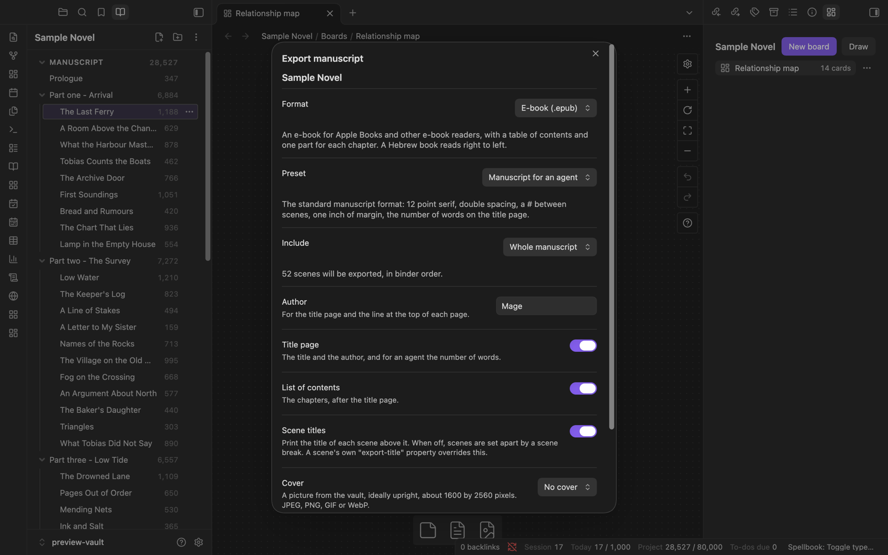

*The export window set for an e-book: the format, the preset, what to include, the switches, and the choice of a cover.*

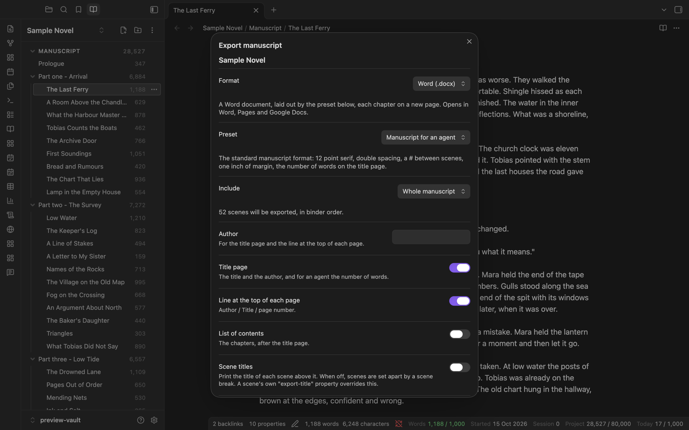

*The export window for a web page, which also offers the line at the top of each page.*

**What it is for.** Putting the manuscript into one file to send or print, with the scenes in binder order. Scenes whose "Include in compile" switch is off are left out.

**How to open it.** Command **Export manuscript**. It has no ribbon button.

**What you choose.**

- **Format**:
  - **Word (.docx)**: a Word document laid out by the preset, each chapter on a new page.
  - **E-book (.epub)**: an e-book for Apple Books and other e-book readers, with a table of contents and one part for each chapter. A Hebrew book is marked as Hebrew and its pages turn right to left. You can choose a **Cover**: a JPEG, PNG, GIF or WebP picture from the vault, ideally upright (about 1600 by 2560 pixels). Pictures inside the project folder are listed first.
  - **Web page (.html)**: one page that opens in any browser.
  - **Markdown (.md)**: one note with the whole text, as you wrote it.
  - **Print / save as PDF**: makes a page laid out for printing and opens it in your browser, where you choose "Save as PDF". The top of the page says which paper and margins to choose.
- **Preset**: how the pages look. Choosing one also sets the switches below to where it starts them; you can still change them.
  - **Manuscript for an agent**: the standard manuscript format. 12 point serif, double spacing, a # between scenes, one inch of margin, the number of words on the title page, "Author / Title / page" at the top of each page.
  - **Reading copy**: like a book. Normal spacing, lines flush with both margins, large chapter titles, three stars between scenes, a list of contents, no word count and no line at the top.
  - **Proof**: for marking up on paper. Double spacing, two inches of margin at the sides to write notes in, scene titles printed. Word also numbers the lines; the other formats cannot.
- **Include**: **Whole manuscript**, or one folder.
- **Author**, and switches for **Title page**, **Line at the top of each page**, **List of contents** and **Scene titles**.
- **Paper**: A4 or US Letter.
- **Front and back matter** (folded away; tap to open): a **Dedication**, an **Epigraph**, **Acknowledgements** and **About the author**. For each, choose **None**, **Write it here** (a box to type in) or **From a note** (any note of the project, for example one in Research). The dedication and the epigraph come after the title page, each on a page of its own; the acknowledgements and about the author come at the end, with headings. A heading on the first line of the text (`# With thanks`) becomes the page's heading; otherwise the acknowledgements are headed "Acknowledgements" and about the author "About the Author", or their Hebrew words in a Hebrew book. In an e-book each is a part of its own; in Markdown the epigraph is a quote.
- **Headings** (folded away; tap to open): the headings the book writes by itself, each in a box of its own: **List of contents**, **Dedication**, **Epigraph**, **Acknowledgements** and **About the author**, and for an e-book also **Cover**, **Title page** and **Start of the text**, the entries of an e-book reader's menu. An empty box keeps the usual word, shown in grey, in the language of the book (English, or Hebrew for a Hebrew book). Type your own to use it instead, for example a different wording of "About the Author". A dedication and an epigraph have no heading unless you type one here. A heading on the first line of a page's own text still comes first.

The window remembers your last choices for each project, on this device, typed front and back matter and headings included.

**Per-scene choices.** Two scene properties change how one scene goes out. The inspector does not show them: add them in Obsidian's properties of the scene note.

- `export-page-break: true` starts the scene on a new page (in an e-book, a new part). A scene that is first under its chapter heading already starts a page.
- `export-title: true` prints the scene's title above it even when **Scene titles** is off; `export-title: false` never prints it.

Press **Export**. The file is saved as a new file in the project's Exports folder; an export never replaces an earlier one. A small window then says that the manuscript was exported, the name of the file and the folder of the vault it is in, how many scenes and words were saved and which scenes were left out. It stays until you close it. Its buttons: **Show in file list** brings Obsidian's file list to the front (on a phone, the drawer at the side) and points at the file; **Open** opens it; **OK** closes the window.

**On a phone.** "Print / save as PDF" is not offered on a phone or tablet. Export the web page instead, open it in the browser or the Files app, and print it from the share menu, which offers to save it as a PDF.

**Limits.** There is no direct PDF file: the browser's "Save as PDF" sets Hebrew correctly, and a PDF written by Spellbook itself could not (see [the PDF study](pdf-study.md)). Safari leaves out the line at the top of each page when it prints. The e-book has been checked by automated tests that open it again, not in Apple Books or another reader, and not with the official EPUB checker. The Word file was checked by converting it with macOS tools, not by opening it in Word, Pages or Google Docs. Word and web-page files only show in Obsidian's file list when Obsidian's "Detect all file extensions" setting is on. The button that shows the file in its folder is on computers only.

## For AI assistants

**What it is for.** A project is plain notes, so an AI assistant can read it and help with it. The AI helper is a reference written for that assistant: what each folder and property means, how to read the manuscript in order, which changes are safe to make and how, and what it must never touch (the word logs, the snapshots, the order numbers of scenes). Spellbook itself contains no AI and sends nothing anywhere; the reference is only text for an assistant of your choosing.

**How to get it.** Command **Create AI helper note**. It writes the reference into the open project as `AI helper/Spellbook for AI assistants.md`, making the folder if it is not there, and then offers to open the note.

- If the project already has the note and it is up to date, nothing is written.
- If the note there says something else, because you changed it or because it was made by another version, Spellbook asks before replacing it. **Cancel** keeps your note.

**How to use it.** Paste the note into a chat before you ask your question, or tell an assistant that works with the files of your vault to read it first. The same file is in the plugin's repository, in the folder `AI helper`, with a page of example requests.

**What the assistant is told.** To read a file again before changing it; to change properties and never the text of a scene unless you ask for that scene; to ask you before anything that cannot be undone; and to leave moving, renaming and deleting scenes to you, in the binder.

**Limits.** The note is not a scene: it has no place in the binder, is not exported, and its words are not manuscript words. Words an assistant adds to your notes from outside Obsidian do not show in the daily word counts or the streak, which count typing in Obsidian only; the project total does include them. The command has been checked by automated tests and has not been tried on screen.

## Settings

Open Obsidian's Settings and choose **Spellbook**. The page shows the installed version, the **Projects in this vault**, **Renaming** ("When a note is renamed, update links in": **This project only**, as it comes, or **The whole vault**; see [Binder](#binder), "Renaming"), and these sections, each described above: **Writing progress** (with the bottom bar), **Colour scheme**, **Writing modes**, **Prose checks**, **Snapshots**, **Plot grid** ("Mark long gaps" and "Shade before and after"), **Welcome and help** ("Show the welcome page again" and "Show what is new after updates") and **Templates** (the list of templates, with **Open** and **Delete**), and a row for the writing report's words on a page.

[Making Spellbook your own](customising.md) goes through these settings one by one, and ends with a table of where each setting lives.

Every choice on this page is kept on the device you make it on. See [Sync and several devices](#sync-and-several-devices).

## All commands

Obsidian shows each of these with "Spellbook:" in front.

| Command | What it does |
| --- | --- |
| Create project | Asks for a name and a location and makes a new project. |
| Create sample project | Makes a ready-made novel to try things on. |
| Open binder | Shows the binder in the left sidebar. |
| New scene | Adds a scene next to the one you are working on. |
| New folder | Adds a folder next to the row in use. |
| Move scene up | Moves the open scene one place earlier. |
| Move scene down | Moves the open scene one place later. |
| Reveal active scene in binder | Shows the binder with the open note's row selected. |
| Open corkboard | Shows the corkboard. |
| Open inspector | Shows the inspector in the right sidebar. |
| Manage statuses and labels | Opens the window that edits the two lists. |
| Open outliner | Shows the outliner. |
| Open novel view | Shows the manuscript as one continuous page. |
| Toggle Zen mode | Switches Zen mode on or off. |
| Toggle letter box mode | Switches letter box mode on or off. |
| Toggle typewriter mode | Switches typewriter mode on or off. |
| Toggle Hemingway mode | Switches Hemingway mode on or off. |
| Toggle prose checks | Switches all the prose checks on or off. |
| Toggle prose check: colour nouns | Switches this one check on or off. |
| Toggle prose check: colour verbs | Switches this one check on or off. |
| Toggle prose check: colour adjectives | Switches this one check on or off. |
| Toggle prose check: colour adverbs | Switches this one check on or off. |
| Toggle prose check: filler words | Switches this one check on or off. |
| Toggle prose check: passive voice | Switches this one check on or off. |
| Toggle prose check: repeated words | Switches this one check on or off. |
| Toggle prose check: overused adverbs | Switches this one check on or off. |
| Toggle prose check: sentence rhythm | Switches this one check on or off. |
| Choose colour scheme | Opens the list of colour schemes. |
| Next colour scheme | Steps to the next colour scheme. |
| Set writing targets | Opens the window for project, daily and scene targets. |
| Open planner | Shows the calendar and the to-do list. |
| Open to-do note | Opens the project's `To-do.md`. |
| Open writing report | Shows the writing report. |
| Open timeline | Shows the timeline. |
| Edit story calendar | Opens the window that defines the story's calendar. |
| Open world history | Switches the timeline to the World history view: the world lanes on and the Manuscript lane off, fitted to the world's dates. |
| Open plot grid | Shows the scenes in binder order against plotlines, labels, characters or places, with a tick where a scene belongs to one. |
| New idea board | Makes an empty idea board in the project's Boards folder and opens it in Obsidian's Canvas. |
| Open idea boards | Shows the project's idea boards, with what each holds. |
| Turn board cards into notes | Turns text cards of a board into scenes or World entries; each card then shows its new note. |
| Board: relationship map | Draws a new board of the characters and the relations between them. |
| Board: chapter as cards | Draws a new board of one folder's scenes as cards in reading order. |
| Board: around this entity | Draws a new board with one World entry in the middle and what it is linked to around it. |
| Save scene as template | Saves the open scene's properties and text as a template for new scenes in this project. |
| Save as World template | Saves the open World entry's fields and text as a template for new entries of its type. |
| Save project as template | Saves the project's folders and scene titles and synopses (and, if asked, their text) as a template for new projects. |
| Open world | Shows the World screen. |
| New character | Makes a character note. |
| New place | Makes a place note. |
| New faction | Makes a faction note. |
| New item | Makes an item note. |
| New lore | Makes a note for a legend, a tale or a piece of history. |
| New creature | Makes a creature note. |
| New culture | Makes a note for a people or a language. |
| New entity | Asks for a type, then makes a note of it. |
| Open entity sheet | Shows the sheet of the entity whose note is open. |
| Take snapshot | Saves the open scene as it is now. |
| Snapshots of this scene | Shows the saved versions of the open scene. |
| Add revision note | Pins a note to the words selected in a scene. |
| Open revision notes | Shows every revision note of the manuscript, by scene, in the right sidebar. |
| Find and replace in the manuscript | Finds words in all scenes or one folder and replaces the places you tick, after a snapshot of each scene. |
| Rename everywhere | Renames the open World entry, keeps its old name as another name, and changes its name in the manuscript's text where you tick. |
| Export manuscript | Opens the export window. |
| Create AI helper note | Writes the reference for AI assistants into the open project. |
| Open welcome page | Shows the welcome page again. |
| Help | Shows the tutorial in short, every command, and the addresses of this guide and the tutorial. |
| Show me around | A short tour of the screen: the binder, the inspector, the bottom bar and the ribbon buttons. |
| Show what is new | Shows what changed in the version you have. |

Ribbon buttons: "Open Spellbook binder", "Open Spellbook corkboard", "Open Spellbook planner", "Open Spellbook timeline", "Open Spellbook outliner", "Open Spellbook writing report", "Open Spellbook novel view", "Open Spellbook world", "Open Spellbook plot grid", "Open Spellbook idea boards" and "Open Spellbook revision notes".

## How your writing is stored

A project is an ordinary folder of Markdown notes. You can read and edit all of it without the plugin, and if you stop using Spellbook your book is still there.

### The folders

```
<Project>/
  <Project>.md   the project index
  To-do.md       to-dos as plain checkbox lines
  Manuscript/    one note per scene (or per chapter)
  Timeline/      one note per timeline event
  Research/      your research notes
  Stats/         daily word logs, one file per device per month
  World/         one note per character, place, piece of lore and so on, in a folder per type
  Snapshots/     saved versions of scenes, one folder per scene
  Exports/       exported manuscripts
  AI helper/     the reference for AI assistants
  Boards/        idea boards, as Obsidian Canvas files
  Templates/     templates for new scenes (Scenes/) and World entries (World/)
```

The first six are made with the project. World, Snapshots, Exports, AI helper, Boards and Templates are made the first time you use them.

Project templates are kept apart from any project, in a folder called "Spellbook templates" at the top of the vault, made the first time you save one.

The **project index** is the note named after the project. Its properties hold the order of the binder, the lists of statuses and labels, the targets, the timeline lanes, the story calendar, the day marks, the entity types and the author's name for exports. It also says which notes are whole chapters (`chapters`) and, for a project written in chapters, `writes-in: chapters`.

### The properties of a scene

A scene is a note in the Manuscript folder. Spellbook reads and writes these properties at the top of it:

| Property | What it holds |
| --- | --- |
| `synopsis` | The short summary shown on cards and in the outliner. |
| `status` | The scene's status, for example "First draft". |
| `label` | The scene's label. |
| `target` | The scene's word target. Only there when the scene has one. |
| `compile` | Whether the scene is included in an export. |
| `export-page-break` | `true` to start the scene on a new page in an export. Not shown in the inspector; add it yourself. |
| `export-title` | `true` or `false` to print or hide the scene's title in an export, whatever the window says. Not shown in the inspector; add it yourself. |
| `order` | The scene's place in the binder, as a number. The index decides the order; this copy is there so that other tools can sort by it. |
| `created` | The date the scene was started. |
| `edited` | The date the scene was last edited. |
| `entities` | Links to the characters, places and other entities in the scene. Only there once you add one. |
| `snapshot-id` | A short id that ties the scene to its snapshots. Only there after the first snapshot. |
| `revision-notes` | Where earlier versions kept the scene's revision notes. Spellbook moves them into the project's "Revision notes.json" when the project is opened, and takes the property out of the scene. |

Spellbook also reads `date` (a scene with a date shows in the timeline's Manuscript lane) and `tags` (shown in the outliner). Any other property is yours, and is left alone.

Timeline events carry `date`, an optional `end`, `timelines` (their lanes), `scenes`, `entities` and `tags`. World notes carry `type`, the fields of their type (a character's `role`, a place's `kind` and so on), `summary`, `aliases` (other names) and whatever properties you give them. Two more are only there once you use them: `image`, a link to the entity's picture, and `related`, a list of links to other entities in which each link's display text is the label, for example `[[Ellen|sister]]`.

### What Spellbook changes, and what it never does

- **The text of a scene is yours.** Spellbook changes a scene's properties, and never its text, with two exceptions, both after you confirm and both after a snapshot of the scene: when you press **Restore** on a snapshot (the scene's text is replaced by the snapshot's, after a "Before restore" snapshot), and when you **Replace** in Find and replace or **Rename** in Rename everywhere (only the places you ticked are changed, after a "Before replace" or "Before rename" snapshot, and never in a scene that changed since the search). The properties are never changed by a replace.
- **The same goes for your event, world and research notes**: Spellbook changes their properties only.
- **Links follow a rename.** When you rename a scene, a board or a World entry in Spellbook, the links to it are pointed at the new name, in the text and properties of the notes that hold them and on idea boards. Only the name inside each link changes. This reaches the notes of the project only, unless you chose "The whole vault" in Spellbook's settings.
- **`To-do.md` is the one note whose lines Spellbook edits**, and only the line you acted on: ticking, adding, re-dating, moving or removing a to-do in the planner. Every other line is kept exactly as it was.
- **The word logs, the snapshots, the exports, the AI helper note, the idea boards and the templates** are files Spellbook writes for itself. Turning a board's cards into notes changes that board's file: each card is swapped for one that shows its new note. An export is always a new file. The AI helper note is only written when you run its command, and a copy you changed is not replaced without asking.
- **Nothing is deleted outright.** Scenes, world notes and snapshots you delete go to the trash (Obsidian's or the system's, as your Obsidian settings say).
- **Notes outside a project folder are never changed**, with two exceptions: a new note in "Spellbook templates", when you run **Save project as template**, and, only if you chose "The whole vault" under "When a note is renamed, update links in", the links in them to a note you renamed in Spellbook.

## Sync and several devices

Spellbook saves nothing outside your vault except small per-device choices, so it works with whatever syncs the vault. It was built with iCloud in mind: it reads a note again before changing it, waits a moment before saving, and never assumes it is the only device writing.

### What syncs

Everything inside the project folder, because it is all notes: scenes and their properties, the binder order, statuses and labels, targets, to-dos, day marks, timeline lanes and events, the story calendar, the world with its pictures' links and relations, snapshots, exports, idea boards, templates and the AI helper note. The "Spellbook templates" folder syncs with the vault too.

The **word logs** sync too. Each device writes its own file for each month (in the Stats folder, named with the month and a short id of the device), so two devices never write the same file. The calendar adds all the devices' logs together.

### What is kept on each device

These are remembered separately on every device and do not sync:

- which project is open, and which binder folders are folded shut;
- the colour scheme;
- which writing modes are on, and their settings;
- which prose checks are on, and their settings;
- the layout of the bottom bar, and "Count pasted text";
- the snapshot settings (automatic snapshots, and how many to keep);
- where links are updated when a note is renamed (this project only, or the whole vault);
- the corkboard's card size, and the outliner's columns, sorting and filters;
- whether the World screen shows cards or a list;
- the plot grid's kind of columns, chosen entities, folded folders, synopsis line, gap length and shading before and after;
- whether the welcome page and the note after an update have been shown;
- which timeline lanes are hidden;
- the place you were reading in the novel view;
- the last choices in the export window, and "Words on a page" in the writing report;
- the short id that names the device in its word logs.

"Session words" in the bottom bar counts what you wrote on this device since Obsidian was opened.

### When two devices change the binder at once

If two devices reorder the binder before they have synced, iCloud keeps both versions of the project index: the note itself and a copy next to it. Spellbook does not treat the copy as a second project. The binder shows a notice that a conflicting copy was found, with two buttons:

- **Merge** adds the scenes that only the copy lists to the end of the manuscript, keeps everything the index already has, and moves the copy to the trash.
- **Dismiss** hides the notice and changes nothing.

### Advice

Let iCloud finish syncing before you start writing on another device, especially after reordering scenes. Syncing across real devices has not been tested yet; the handling of conflicting copies and of the change of day at midnight is proven by automated tests only.

## Known limits

Spellbook is at version 0.10.0 and has not been used for real writing yet. This list is taken from the project's status notes of 14 October 2026.

**How far it has been checked**

- Nothing has been tried on a real iPhone or iPad. Phone behaviour was checked in Obsidian's phone layout on a Mac, and not for every screen.
- Typing was tested with simulated input. Real key presses, the iPhone keyboard and autocorrect are untested.
- The change of day at midnight, and writing a second project's word log, are proven by automated tests only.
- Spellbook is not in Obsidian's community plugin list.

**Novel view**

- Read and tap, not edit in place.

**Plot grid**

- The Characters and Places columns show only the built-in Character and Place types; other types need "Chosen entities".

**Idea boards**

- Turning a card into a note is a command and a menu entry in the pane, not an entry in the card's own menu on the Canvas.
- Canvas has six colours, so blue is drawn as cyan and pink as purple.
- A drawn board does not follow later changes; draw it again.
- Not tried in Canvas on an iPhone or iPad.

**Templates**

- Saving refuses a name already in use; it never replaces a template.

**Snapshots**

- The first snapshot of a scene writes a `snapshot-id` property into that scene.
- Restore keeps the scene's current properties unless "Also restore properties" is ticked.
- Deleting a scene leaves its snapshots.
- Automatic snapshots were not tried on screen.

**World**

- With two projects in one vault that share an entity name, Obsidian's own Properties panel may open the other project's note when the link is clicked. Spellbook's own screens go to the right one.
- A picture must already be a file in the vault; Spellbook does not import pictures.
- A relation is written in one note. The other side shows it as "Mentioned by" and cannot change its label there.
- Not tried on screen: rename, delete, "Find mentions", types of your own.

**AI helper**

- The command was checked by automated tests only, not on screen.
- The reference describes this version's files. After an update, run the command again and let it replace the note.

**Timeline and story calendar**

- Switching calendar changes no note; dates that do not fit show as undated until set again.
- Dates sort as text only within one era.
- The date pickers in the event window were not tried on screen.

**Bottom bar**

- On phones and tablets, shortcut buttons show at the top of the inspector, not in a bar.
- A long bar takes at most 60% of the window and scrolls sideways, so its last figures are off-screen until scrolled.

**Export**

- No direct PDF file; use "Print / save as PDF" on a computer, or print the web page on a phone or tablet.
- The e-book has not been opened in Apple Books or another reader, nor run through the official EPUB checker.
- The Word file was checked by converting it with macOS tools, not by opening it in Word, Pages or Google Docs.
- Exported Word and web-page files only show in Obsidian's file list when "Detect all file extensions" is on.
- "Show in file list" shows the file in Obsidian's own file list, not in Finder or another app of the device.

**Writing report**

- Link addresses and code blocks count as words, as they do in the binder.
- Each line of text is one paragraph.
- The Hebrew reading level is an approximate index (LIX), not an established Hebrew formula.
- Whole-manuscript and Hebrew reports were not looked at on screen.

**Prose checks**

- English word colouring is right about nine times in ten, worse in dialogue.
- Hebrew repeated-word matching strips attached letters and gives occasional false matches.
- The bubble that explains a mark was not tried on screen.

**Colour schemes**

- A scheme keeps its own colours whatever Obsidian's light or dark setting is.
- Pop-out windows are not recoloured.

**Writing modes**

- Typewriter scrolling while typing was not watched on screen.

**Outliner**

- Tags come from a note's properties, not from #tags written in the text.

**Not built**

- Maps.
