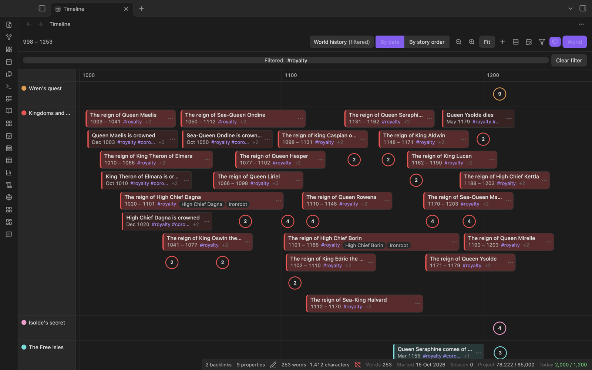
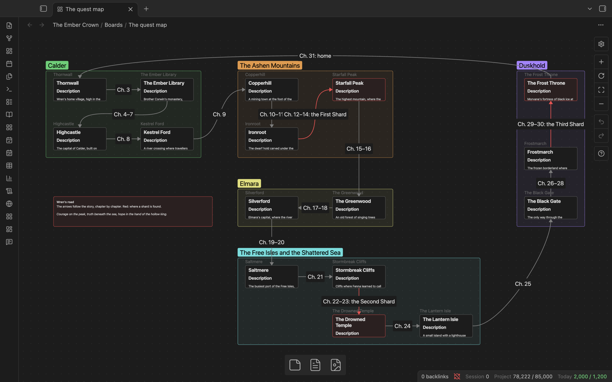
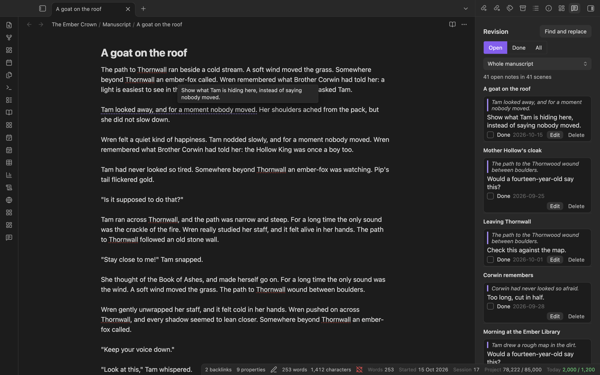

# Spellbook in five minutes

Spellbook turns an Obsidian vault into a place to plan and write a novel, with the tools of a dedicated novel-writing app in the style of Scrivener: a binder, a corkboard, word targets, a story timeline, a world of characters and places, revision notes and a manuscript export. Your book stays a folder of plain notes. It works on a computer, an iPad and an iPhone, in English and in Hebrew or any other right-to-left language.

## Install in three steps

1. In Obsidian, open **Settings**, then **Community plugins**, and install and enable **BRAT**.
2. In **Settings**, then **BRAT**, choose **Add beta plugin** and paste `https://github.com/ArcMages/SpellBook`.
3. Run the command **Spellbook: Create sample project** to get a sample novel with every screen filled in.

Other ways to install, and what to do on an iPhone or iPad, are in [Installing Spellbook](installing.md).

## Binder and corkboard

The binder in the left sidebar holds the book as a tree of parts, chapters and scenes; drag to reorder. The corkboard shows the same book as index cards, each with its synopsis, status, coloured label and word count.

## Chapters or scenes, or both

Write one note per scene, one note per chapter, or mix the two in the same book. A chapter note is marked in the binder and on the corkboard, and gets its own heading in the novel view and the export.

## Writing modes and prose checks

Zen mode, letter box, typewriter scrolling and Hemingway mode (no deleting, only forward) help you keep writing. Prose checks mark filler words, repeated words and long sentences without ever changing your text.

## Track your words

Word counts for the scene, the session, the day and the project sit in a bottom bar you arrange, with targets, a deadline, a writing calendar and a writing report. Rather not see the numbers while you write? Take any figure off the bar, or all of them.

## Timeline, story calendar and world history

Story events sit as cards in coloured lanes on one time axis, next to the scenes that have a date. Give your world its own calendar of named months and days, then step back to centuries of world history: reigns, wars and lives as bars, filtered by tag.

## World: characters with ages, places, lore

Characters, places, factions, items, lore, creatures and cultures each get a card and a sheet with fields, pictures, nicknames and relations. Give a character a birth year and Spellbook shows their age in every scene, and warns you if someone appears before they are born or after they die.

## Plot grid

Scenes down the side, plotlines across the top (or labels, characters or places), with a tick where they meet. Long gaps are shaded, so you can see where a plotline or a character drops out of the book.

## Idea boards

Brainstorm on Obsidian's Canvas: a quest map, a cast and their loyalties, ideas for a later part. Turn any card into a scene or a World entry, or let Spellbook draw a board for you, such as a relationship map or a chapter as cards.

## Revision tools

Leave notes on passages for later, and work through them in the Revision pane. Find and replace across the manuscript, rename a character everywhere at once, and keep snapshots of each scene to compare with or go back to.

## Export

Put the whole manuscript into one file: Word, an e-book (EPUB), a web page, Markdown, or a page to print as PDF. Presets, front and back matter, a title page and a list of contents are built in.

## Fast on a full-length novel

Spellbook is tested on a book of about 80,000 words in 290 scenes, with 200 World entries and 300 timeline events. Obsidian starts in under a second, every screen opens in about half a second or less, and typing stays smooth.

## Your files stay yours

A project is an ordinary folder of Markdown notes that you can read and edit without the plugin. Spellbook never deletes anything outright, makes no network requests and collects nothing.

## Learn more

- [Tutorial: your first novel in Spellbook](tutorial.md), a walk-through from an empty vault to a Word file.
- [User guide](guide.md), the reference for every screen and command.
- [Customising](customising.md): colour schemes, shortcuts, the bottom bar, statuses and labels.
