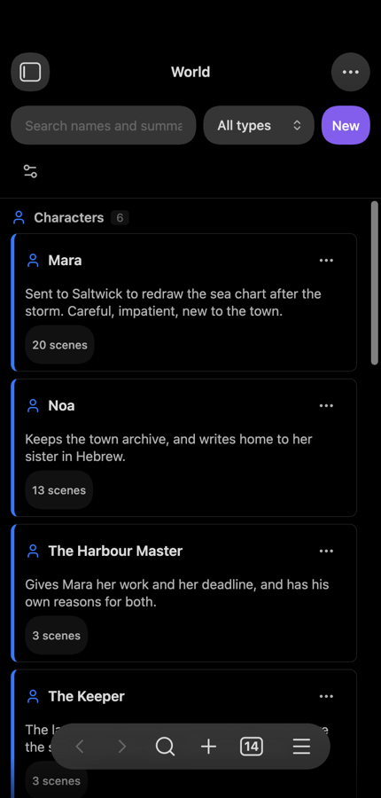
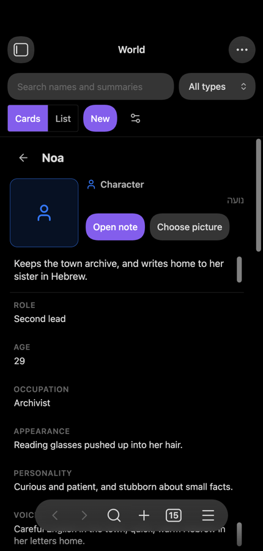
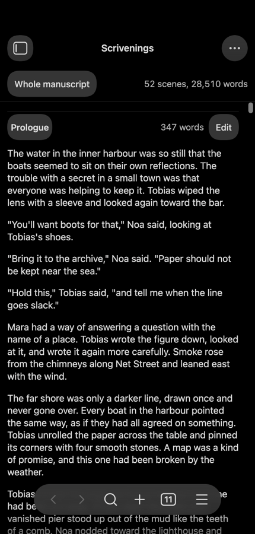
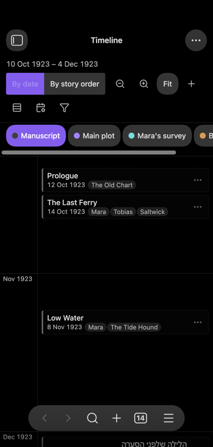

# Your first novel in Spellbook

This is a walk-through. It starts with an empty vault and ends with a Word file you can send to a reader. Each step says what to click and what you should then see. Do it once from start to finish with a made-up book, and you will have used every part of Spellbook.

It takes about an hour. For the full description of any screen, see the [user guide](guide.md). To change how Spellbook looks and behaves, see [Making Spellbook your own](customising.md).

Three things to know first:

- **Commands.** Most steps below say "run the command ...". To run a command, open Obsidian's command palette (press Ctrl+P or Cmd+P on a computer, or swipe down on a phone), type part of the name, and choose it. Obsidian shows every Spellbook command with "Spellbook:" in front. This tutorial gives the names without that prefix.
- **"More options".** Almost every row and card has a small "More options" button that opens its menu. On a computer a right-click opens the same menu.
- **Nothing is deleted outright.** Whatever you delete in Spellbook goes to the trash, so you can try things freely.

## Contents

1. [Install Spellbook and switch it on](#1-install-spellbook-and-switch-it-on)
2. [Look around the sample project](#2-look-around-the-sample-project)
3. [Create your own project](#3-create-your-own-project)
4. [Build the book in the binder](#4-build-the-book-in-the-binder)
5. [Write a scene and fill in its inspector](#5-write-a-scene-and-fill-in-its-inspector)
6. [Plan on the corkboard](#6-plan-on-the-corkboard)
7. [Set targets and watch the bottom bar](#7-set-targets-and-watch-the-bottom-bar)
8. [Plan your writing days](#8-plan-your-writing-days)
9. [Put story events on the timeline](#9-put-story-events-on-the-timeline)
10. [Build the world](#10-build-the-world)
11. [Read the book through](#11-read-the-book-through)
12. [Take a snapshot before a big revision](#12-take-a-snapshot-before-a-big-revision)
13. [Check the prose](#13-check-the-prose)
14. [Read the writing report](#14-read-the-writing-report)
15. [Export a Word file for a reader](#15-export-a-word-file-for-a-reader)

Then: [A daily routine](#a-daily-routine), [Writing on a phone or tablet](#writing-on-a-phone-or-tablet) and [Writing in Hebrew](#writing-in-hebrew).

## 1. Install Spellbook and switch it on

Use a spare vault for this tutorial, not the one your real writing is in.

1. Install the plugin as the [README](../README.md#installing-by-hand) describes: three files copied into the vault's plugin folder.
2. In Obsidian, open **Settings**, then **Community plugins**, and switch on **Spellbook**.
3. Close the settings.

You should now see new buttons in the ribbon (the strip of icons at the side of the window). Point at them to read their names: "Open Spellbook binder", "Open Spellbook corkboard", "Open Spellbook planner", "Open Spellbook timeline", "Open Spellbook outliner", "Open Spellbook writing report", "Open Spellbook novel view", "Open Spellbook world", "Open Spellbook plot grid" and "Open Spellbook idea boards".

Switching the plugin on changes nothing in your vault. Notes are only made when you run a command.

In a vault with no Spellbook project, a page called **Welcome to Spellbook** opens by itself, once. Its buttons start the next two steps for you: **Try the sample novel** and **Start my own project**. **Show me around** points at the main parts of the screen one by one. You can open the page again at any time with the command **Open welcome page**, and the command **Help** lists every command.

## 2. Look around the sample project

The sample project is a made-up novel of about fifty scenes, in English, with characters, places, timeline events and to-dos. It is there so that every screen has something to show.

1. Run the command **Create sample project**. A folder called "Sample Novel" appears in the vault.
2. Run **Open binder**. The left sidebar shows the novel as a tree of folders and scenes, each with its word count.
3. Tap a scene in the binder. It opens in the editor as an ordinary note.
4. Run **Open inspector**. The right sidebar shows that scene's synopsis, status, label and target.
5. Press each ribbon button in turn (corkboard, planner, timeline, outliner, writing report, novel view, world) and look at what it shows. Change whatever you like: this project is for playing with.

The sample has no writing history, so the calendar's word counts start empty. When you are done with it, you can delete the "Sample Novel" folder like any other folder.

## 3. Create your own project

1. Run the command **Create project**.
2. In the window, type a **Name**, for example "The Lighthouse". The project gets its own folder with this name.
3. Choose a **Location**: the folder to create the project in.
4. Leave **Structure** at **Blank** for this tutorial, so that you build the chapters yourself in the next step.
5. Press **Create**.

You should see the new project's first scene open in the editor. In Obsidian's file list there is now a folder named after your book, with the folders Manuscript, Timeline, Research and Stats inside it, a note named after the project, and a note called `To-do.md`.

**Optional: start from a structure.** For a real book you may want a shape to start from. In the same window, choose a **Structure** instead of Blank: **Three acts**, **A fifteen-beat outline**, **The hero's journey** or **Chapter by chapter** (which asks how many chapters). The window lists the folders and scenes it will make; each scene has a synopsis that says what it is for. See [Templates](guide.md#templates).

A vault can hold several projects, and all the screens show one of them at a time. You now have two, the sample and your own. To switch, press the project's name at the top of the binder and choose the other.

## 4. Build the book in the binder

*The binder in the left sidebar, a scene open in the editor, and the inspector in the right sidebar.*

In Spellbook a chapter is a folder in the binder, and a scene is a note inside it.

1. Open the binder if it is not showing (**Open binder**). At the top is your project's name, then a toolbar, then **Manuscript** with the one scene the project started with.
2. Press **New folder** in the toolbar. In the window, type "Chapter 1" and press **Create**. Do it again for "Chapter 2".
3. Open the "More options" menu of "Chapter 1" and choose **New scene inside**. Name it "Arrival" and press **Create**. The scene appears inside the folder and opens.
4. Add two more scenes to Chapter 1 the same way, "The keeper" and "Storm warning", and one scene to Chapter 2.
5. Move the scene the project started with into a chapter: open its menu, choose **Move to folder**, and pick "Chapter 1". If you do not want it, choose **Delete scene** instead; it asks first, then moves the note to the trash.
6. Reorder. Drag "Storm warning" above "The keeper". Then put it back without dragging: open its menu and choose **Move down**.
7. Rename a scene: open its menu, choose **Rename**, type the new name and press **Rename**.

You should now see two folders under Manuscript, each with its scenes in the order you chose, and a word count of 0 on every row.

Good to know:

- Dragging and the menu do the same things. Use whichever suits your hand.
- A folder can hold folders. Use **New folder inside** for parts that hold chapters.
- A note you make in Obsidian's own file list inside the Manuscript folder shows under **Unfiled** in the binder. Its menu has **Add to manuscript**.

## 5. Write a scene and fill in its inspector

1. Tap "Arrival" in the binder and write a few paragraphs. The word count on its row in the binder follows.
2. Run **Open inspector**. It opens in the right sidebar and shows the scene that is open.
3. In **Synopsis**, write one or two sentences that say what happens in the scene. This is what the corkboard and the outliner will show.
4. Under **Status**, choose **First draft**. A new project has four statuses: To do, First draft, Revised and Final.
5. A new project has no labels yet. Press the **Statuses and labels** button in the inspector. In the window, press **Add label**, type a name (for example the name of a point-of-view character) and give it a colour. Add a second label, then close the window.
6. Back in the inspector, choose one of your labels under **Label**.
7. In **Target (words)**, type 800.

You should see the status, the label and the target stay as you set them when you open another scene and come back. **Created** and **Edited** show today's date; Spellbook keeps those for you.

Leave **Include in compile** on. Switching it off leaves a scene out of an export, which is useful for notes to yourself that sit among the scenes.

## 6. Plan on the corkboard

*The corkboard: one index card per scene, with its title, synopsis, status, coloured label and word count.*

1. Run **Open corkboard**. You should see one card for each chapter folder.
2. Tap the "Chapter 1" card to go into it. Now each scene is a card, and "Arrival" shows the synopsis, status and label you gave it. The trail at the top shows where you are; tap a step of it to go back up.
3. Give the other cards a synopsis without opening them: open a card's "More options" menu and choose **Edit synopsis**. Use **Set status** and **Set label** in the same menu.
4. Drag a card to a new place. The binder follows at once: it is the same order. **Move earlier** and **Move later** in the card's menu do the same without dragging.
5. Try the card sizes **Small**, **Medium** and **Large**. A larger card shows more lines of the synopsis.

This is a good way to plan a book before writing it: make the scenes, write only their synopses, and move the cards around until the order feels right.

If you would rather see the same information as a table, run **Open outliner**. It lists every scene in rows, with status, label, target, words and synopsis in columns, and you can change most of them in place.

## 7. Set targets and watch the bottom bar

1. Open "Arrival" again.
2. Run the command **Set writing targets**. The window is called "Writing targets".
3. In **Project target (words)** type 80000. In **Daily target (words)** type 500. Choose a **Deadline** if you have one. **Target for the open scene (words)** already shows the 800 you typed in the inspector.
4. Press **Save**.
5. Look at the bar at the bottom of the Obsidian window. For the open scene it shows the scene's words, the date it was started, the date it was last edited, the words of this session, the words of the project and the words written today.
6. Type a sentence. The scene, session, project and today figures go up as you write.
7. Click any figure in the bar. The "Writing targets" window opens again, which is the quickest way to it.

Two things to know about the counting:

- "Session" counts what you wrote on this device since Obsidian was opened. "Today" counts net words: what you added minus what you deleted.
- Pasted text does not count as written unless you switch on **Count pasted text** in the settings.

You can choose which figures the bar shows, and add buttons to it. See [The bottom bar](customising.md#the-bottom-bar).

On a phone there is no bottom bar. The same figures stand at the top of the inspector.

## 8. Plan your writing days

*The planner: the month on one side, with words written, to-dos due and day marks, and the to-do list on the other.*

1. Run **Open planner**. You should see a month calendar and a to-do list. Today is tinted, because you have written words today.
2. In the to-do list, type "Check tide times for chapter 2" in the box "Add a to-do", give it a due date a few days from now, and press **Add**.
3. Look at the calendar: the day you chose now has a dot.
4. Tap that day. A panel shows **To-dos due** for the day, a box to add another to-do for it, and **Mark**.
5. Under **Mark**, choose a colour and type a short label, for example "Draft ch. 1 done". The day now carries that mark. **Remove mark** takes it off again.
6. Back in the to-do list, tick a to-do to finish it. It moves under **Done**.

The calendar also shows the words of the month and of this week, your streak, your daily average and today's target.

Your to-dos are plain checkbox lines in the note `To-do.md` in the project folder. You can edit that note by hand, and the command **Open to-do note** opens it.

## 9. Put story events on the timeline

*The timeline: named, coloured lanes on one time axis, with events as cards.*

The timeline is for what happens in the story and when, which is not always the order the book tells it in.

1. Run **Open timeline**. An empty timeline says "No events yet. Tap a lane to add one."
2. Make a lane for a plot line. Press **Lanes**; in the "Timeline lanes" window press **Add lane**, type "Main plot" and confirm. Add a second lane, "The keeper's past". Give each a colour from its menu (**Colour**), then close the window.
3. Press **New event**. Type a **Title**, for example "The ship is sighted", and a **Date**. A date can be a year, a year and month, or a full date: 1923, 1923-04 or 1923-04-12. Leave **End date (optional)** empty for something that happens on one day. Press **Create**.
4. Add two more events, and give one of them an end date. An event with an end date shows as a span; one without shows as a point.
5. Drag an event along the axis. Its date changes. **Move earlier** and **Move later** in its menu do the same.
6. Open an event's menu and choose **Move to lane** to put it in another lane, or **Also show in lane** to show it in two.
7. Use **Zoom in**, **Zoom out** and **Fit** to see more or less time at once.
8. Press **By story order** to see things in the order the book tells them, and **By date** to go back.

Each event is a note in the project's Timeline folder. Open it (tap it, or **Open** in its menu) to write as much about the event as you like.

Scenes can appear on the timeline too: a scene whose note has a `date` property shows in the built-in **Manuscript** lane.

If your story is set in an invented world with its own months, see [An invented story calendar](customising.md#an-invented-story-calendar).

## 10. Build the world

*The World screen: a card for each character, place, faction, item, piece of lore, creature and culture of the story.*

The world is everything the story is about that is not a scene: its people, its places, its legends. Each is an **entity**, a plain note in the project's World folder.

**Make a character**

1. Run the command **New character**. Type a name and confirm. A note for the character opens, with empty properties (role, age, occupation, appearance, personality, voice, goal, arc and a summary) and three headings to write under: Appearance, Background and Notes.
2. Run **New place** and add a place the same way.
3. Run **Open world**. You should see a card for each of them. Use the search box, or show one type at a time, when the world grows. **Cards** and **List** switch between cards and a table that you can sort by name, type, kind or number of scenes.

*The same world as a list.*

**Fill in the sheet**

*A character's sheet: the picture, the summary, the fields, then the people and places she is related to and the scenes she is in.*

4. Tap the character's card. The sheet opens beside the cards. (Its **Open note** button opens the note itself.)
5. Type a line in **Summary**, then fill in the fields you know: tap a field, type, and press Enter or tap elsewhere. Each is saved as you leave it. Leave empty what you do not know yet. If the character goes by another name (a nickname, a title, the name in another language), type it under **Nicknames and other names**, just below the picture, in **Add a nickname**, and press Enter. Spellbook finds these names in your scenes too.
6. If you have a picture of the character in your vault, press **Choose picture** and tap it. If not, skip this: the sheet shows the type's icon.
7. Press **Open note** when you want to write at length. The note's text is yours; the sheet only changes its properties.

**Relate two entities**

8. On the character's sheet, find **Related** and press **Add**. In the window, type how the two have to do with each other, for example "lives in", then tap your place. It now stands under **Related**, in the group "Places", with its label.
9. Open the place's sheet. It shows the character under **Mentioned by**, without you writing anything there. A relation is written once, on the side it reads from.

**Say who is in a scene**

10. Open "Arrival", and in the inspector find **In this scene**. Press **Add**, choose your character, then **Add** again and choose the place. Each shows as a chip.
11. You can also make someone new from there: press **Add**, type a name that does not exist yet, and choose what it is.
12. Go back to the character's sheet. Under **Scenes** it now lists "Arrival" with its synopsis.
13. Press **Find mentions**. Spellbook lists scenes whose text names the character without listing them, each with a **Link this scene** button.

**Add a legend**

*A legend has a sheet like any other entity: what kind of tale it is, when it is from, who tells it.*

14. Run **New lore** and give the legend a name, for example "The Bell in the Fog". Lore is for legends, tales, myths, history, religion and customs.
15. Open its sheet and fill in **kind** ("Fishermen's tale"), **period** ("Told to this day") and **told-by** (who in the story tells it). Write the tale itself in the note, under the heading "The tale"; the other two headings are "Who tells it" and "What is true".
16. Relate the legend to the place it is about, and add it to the scene where someone tells it, the same way as for the character.

**Give it a place in time**

17. On the character's sheet, find **Time**. Press **Set** beside **Born** and type a date, for example 1889 or 1889-04-17. A place says **Founded** instead, an item **Made**. Press **Add moment**, give the date 1923-10 and the words "comes to the town", and confirm.
18. Under **History** the sheet now lists the birth, the moment and every dated scene or event the character is in, in order of time. On the timeline, press **World** to see a lane for each type, or run **Open world history** to see the whole world's past at once.

To tie an entity to a timeline event, open the event's menu on the timeline and choose **Entities**. The timeline's **Only events with** button then narrows the timeline to the events that involve the people, places and tales you choose.

**Optional: draw a relationship map**

19. Run **Board: relationship map**. In the window, leave **Character** on, switch on **Place** and **Lore** as well, and press **Draw board**.
20. A board opens in Obsidian's Canvas, with a card for each entity and an arrow for each relation, labelled "lives in" and so on. Move the cards about as you like; the board is yours, and the World does not change. Run **Open idea boards** to see it listed with your other boards. See [Idea boards](guide.md#idea-boards).

**Optional: check the plot grid**

21. Run **Open plot grid**, press **Columns** and choose **Characters**. Each scene is a row and each character a column, with a tick where the character is in the scene. "Arrival" has a tick under your character.
22. Tap an empty cell to put that character in that scene, and tap the tick again to take them out. It is the same as **In this scene** in the inspector.
23. In a longer book, a grey stretch in a column shows where a character has been missing for many scenes in a row. Choose **Timeline lanes** or **Labels** under **Columns** to follow plot lines the same way. See [Plot grid](guide.md#plot-grid).

Besides characters, places and lore there are factions, items, creatures and cultures, each with its own command (**New faction**, **New item**, **New creature**, **New culture**), and you can add types of your own. See [Entity types of your own](customising.md#entity-types-of-your-own).

## 11. Read the book through

*The novel view: the scenes one after another as a single page, each under a small divider with its title and word count.*

1. Run **Open novel view**. You should see your scenes as one continuous page, in binder order.
2. At the top, choose **Whole manuscript** or one folder, to read just a chapter.
3. Read. When you find something to fix, tap that paragraph. The scene's own note opens in the editor at that place.
4. Make the change. When you go back to the novel view, it shows the change.

The novel view is for reading. You cannot type in it; tap to open the scene and edit it there. It remembers where you were reading.

## 12. Take a snapshot before a big revision

*Comparing a snapshot with the scene as it is now: added text is underlined and marked with a plus, removed text is struck through and marked with a minus.*

A snapshot is a saved version of one scene. Take one before you rewrite, and you can always go back.

1. Open "Arrival".
2. Run **Take snapshot**. Give it a name, for example "before the rewrite", or leave the name empty, and confirm. A notice says "Snapshot taken."
3. Now revise boldly: delete a paragraph, rewrite another, add a new one.
4. Run **Snapshots of this scene**. The Snapshots screen opens as a tab, listing the snapshot with its name, date, word count and how many words differ from the scene now.
5. Press **Compare**. You should see what was added and what was removed since the snapshot.
6. Decide that the old version was better. Go back to the list and press **Restore**. A window explains what will happen; press **Restore** to confirm.
7. Look at the scene: the old text is back. Look at the list: there is a new snapshot called "Before restore" holding the revised text, so the restore itself can be undone.

Restoring puts back the text only. The scene keeps the status, label, synopsis and other properties it has now, unless you tick **Also restore properties** in the window.

**Take snapshot** and **Snapshots** are also in a scene's menu in the binder. Spellbook can take a snapshot for you before the first edit of each day; see [Snapshot options](customising.md#snapshot-options).

**Notes for the rewrite, and a word changed everywhere.** Select a few words in "Arrival" that you want to come back to, right-click (on a phone, press and hold the selection) and choose **Add revision note**. Type what should change and press **Add note**: the words get a light dotted underline, and pointing at them shows your note. Run **Open revision notes** to see every note of the book in the right sidebar; tick **Done** when you have dealt with one. To change a word all through the book, run **Find and replace in the manuscript**, search, untick any place you want left alone, and press **Replace**: each scene is saved as a snapshot first. See [Revision](guide.md#revision).

## 13. Check the prose

*Prose checks in the editor: marks under filler words, repeated words and the passive voice, and a tint on very long sentences.*

1. Open a scene with a few paragraphs of English in it.
2. Run **Toggle prose checks**. The first time, this switches on five checks: filler words, passive voice, repeated words, overused adverbs and sentence rhythm.
3. Look at the text. Words and sentences that are worth a second look are underlined or tinted. Point at a mark, or tap it, to see what it is.
4. Fix one: delete a "very", or split a long sentence. The mark goes when the text no longer needs it.
5. Try a single check on its own. Run **Toggle prose check: colour verbs**; every verb takes a colour. Run it again to switch it off.
6. Run **Toggle prose checks** again to switch everything off when you go back to drafting.

The marks only change how the text looks. They never change the text itself, and they are suggestions: a repeated word is often exactly what you meant. They show in the notes of Spellbook projects only.

## 14. Read the writing report

*The writing report: counts, pages, reading time, a reading grade and the most used words of a scene, a folder or the whole manuscript.*

1. Open a scene and run **Open writing report**.
2. At the top, choose what the report is about: **The open scene**, one folder, or **Whole manuscript**.
3. Read the figures: words, characters, sentences, paragraphs, pages, reading time and a reading grade.
4. Scroll to **Most used words**. Switch **Leave out common words** on to hide words such as "the" and "and"; what is left shows the words you lean on. **Show more words** gives a longer list.
5. Go back to the scene, change something, and return. The report says its figures are out of date. Press **Refresh**.

Under the pages figure, **Words on a page** sets what counts as one page. It starts at 250, the usual figure for a manuscript.

## 15. Export a Word file for a reader

*The export window: choose the format, what to include, and the options for the title page and the list of contents.*

1. Run the command **Export manuscript**.
2. Under **Format**, choose **Word (.docx)**. This gives standard manuscript format: 12 point serif, double spacing, a # between scenes and each chapter on a new page.
3. Under **Include**, choose **Whole manuscript**, or one folder to send a single chapter.
4. Type your name in **Author**, and switch **Title page** on.
5. Choose the **Paper**: A4 or US Letter.
6. Press **Export**.

You should see the window say how many scenes and words were saved, and which scenes were left out because their "Include in compile" switch is off. Press **Open** to open the file. On a computer there is also a button that shows the file in its folder.

The file is in the project's Exports folder. Every export is a new file; an export never replaces an earlier one.

The other formats are **Web page (.html)**, **Markdown (.md)** and **Print / save as PDF**, which opens a page laid out for printing in your browser, where you choose "Save as PDF".

That is the whole path, from an empty vault to a file for a reader.

## A daily routine

A suggested rhythm, once the book is under way. Change it to suit you.

**Before writing (two minutes)**

1. Open the planner. Look at what is due today and at today's target.
2. Open the corkboard or the binder and choose the scene for today. Read its synopsis.

**Writing**

3. Open the scene. If it is one you have already drafted and mean to change, run **Take snapshot** first.
4. Switch on a writing mode if it helps you stay in the text: **Toggle Zen mode** hides the interface, **Toggle typewriter mode** keeps your line at one height, **Toggle letter box mode** lights only a band of lines, and **Toggle Hemingway mode** refuses deleting so a draft only moves forward. Press Escape to leave Zen.
5. Write until the "today" figure in the bottom bar reaches your daily target.

**After writing (five minutes)**

6. In the inspector, update the scene's **Status**, and fix its **Synopsis** if the scene turned out differently from the plan.
7. Add a to-do in the planner for anything you noticed and did not want to stop for.
8. If something new happened in the story, add it to the timeline; if someone new walked in, add them to the world and to the scene.

**Once a week**

9. Read the week's scenes in the novel view.
10. Open the planner and look at the words of the week and your streak.
11. Run the prose checks and the writing report on finished scenes, not on first drafts.

## Writing on a phone or tablet

Spellbook is built to work on a phone and a tablet as well as on a computer. This has been checked in Obsidian's phone layout on a Mac. It has not yet been tried on a real iPhone or iPad, so read this section as how things work by design.

Everything in this tutorial applies, with these differences:

- **Commands.** Swipe down to open the command palette. You can also put the commands you use most on Obsidian's toolbar above the keyboard; see [Phone and tablet toolbar](customising.md#phone-and-tablet-toolbar).
- **Dragging.** Rest a finger on a row or a card to pick it up, then drag. Every drag also has a menu entry (**Move up**, **Move down**, **Move earlier**, **Move later**, **Move to folder**), so you never have to drag.
- **Leaving Zen.** There is no Escape key, so Zen shows a small "Leave Zen mode" button in the corner of the screen.
- **Layouts follow the width of the pane.** A narrow pane gets a narrow layout, on any device.

### The inspector carries the word figures

*The inspector in phone layout: the word figures that a computer shows in the bottom bar stand at the top.*

A phone has no bottom bar, so the line of figures (scene words, session, today and the rest) stands at the top of the inspector. The shortcut buttons you add to the bar appear there too, on a phone and on a tablet.

### World

*The World screen in phone layout: one column of cards.*

A narrow pane shows one column of cards. Opening an entity's sheet takes the place of the list, with a button that leads back.

*A character's sheet in phone layout: the same fields in one column, with the arrow that leads back to the list.*

### Novel view

*The novel view in phone layout: the same continuous page, with a header laid out for a narrow pane.*

Reading works the same. Tap a paragraph to open its scene at that place.

### Timeline

*The timeline in phone layout: one lane at a time, with time running from top to bottom.*

A narrow pane shows one lane at a time, with a row of buttons to switch lane. Slide with one finger to move along the timeline and pinch with two to zoom. Narrow cards show the first entity chips whole and then a "+N" chip for the rest.

### Other differences

- **Planner.** The calendar and the to-do list become two tabs, **Calendar** and **To-dos**.
- **Outliner.** A narrow pane shows a shorter list of columns.
- **Snapshots.** A comparison is shown in one column instead of side by side.
- **Export.** "Print / save as PDF" is not offered. Export the web page instead, open it in the browser or the Files app, and print it from the share menu, which offers to save it as a PDF.
- **Prose checks.** The marks are worked out when typing pauses, so that the line you are typing is not disturbed.
- **Choices are per device.** The colour scheme, the writing modes, the prose checks and the layout of the bar are remembered on each device separately, so your phone and your computer can be set up differently. Your book itself, with its targets, to-dos, timeline and world, syncs with the vault.

If you write on more than one device, let the vault finish syncing before you start on the next one, especially after reordering scenes. See [Sync and several devices](guide.md#sync-and-several-devices).

## Writing in Hebrew

Spellbook supports Hebrew and English, including right-to-left text. Its menus and buttons are in English. Everything you write yourself can be in Hebrew, English or both.

**Right-to-left scenes.** There is nothing to switch on. Write a scene in Hebrew and it reads right to left. Titles, synopses, labels, statuses, character names, lane names, to-dos and day marks each take the direction of their own language wherever they are shown: in the binder, on cards, in the outliner, on the timeline and in the World screen.

**Mixed projects.** One project can hold Hebrew scenes and English scenes, and one card can have a Hebrew title and an English synopsis. Each piece of text is laid out on its own, so Hebrew sits right to left next to English that sits left to right. The sample project has scenes in both languages to try this on.

**Word counts.** Words are counted the same way in both languages, so targets, the bottom bar, the calendar and the report all work for Hebrew.

**What the prose checks do in Hebrew.**

- **Filler words**, **Repeated words** and **Sentence rhythm** work in Hebrew.
- You can add your own Hebrew filler words in the settings, under **Your own filler words (Hebrew)**.
- For repeated words, a Hebrew word counts as the same with or without the letters attached to its front, so "the house" and "in the house" are caught as a repeat.

**What they do not do in Hebrew.**

- The word colours (nouns, verbs, adjectives, adverbs), **Passive voice** and **Overused adverbs** are English only. In a Hebrew scene they mark nothing.
- Stripping the attached letters gives an occasional false match between two different words that happen to look alike once a first letter is taken off. Treat a mark as a question, not a verdict.

**The Hebrew reading level.** For English, the writing report gives the Flesch-Kincaid grade level, which is a school year. Hebrew has no standard formula of that kind, so for Hebrew the report shows **Reading level (approximate)** instead. It is the LIX index: the words in an average sentence plus the share of words longer than six letters. It is not a school year. Use it to compare your own chapters with each other, for example to see that one chapter reads much more heavily than the rest. Do not use it to say what age a book suits.

**Export.** The Word and web-page exports mark Hebrew text as right to left, so a Hebrew manuscript opens the right way round for your reader.

**Not yet checked.** A Hebrew writing report has not been looked at on screen yet, and nothing has been tried with the iPhone's Hebrew keyboard.
